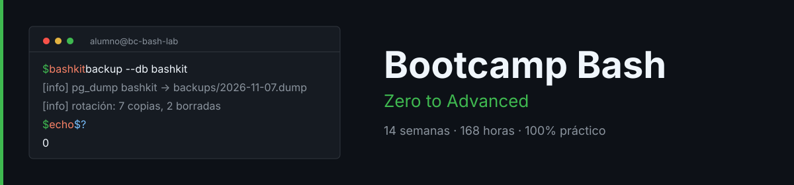

<p align="center">
  
</p>

<p align="center">
  <a href="LICENSE"></a>
  <a href="#"></a>
  <a href="#"></a>
  <a href="#"></a>
</p>

<p align="center">
  <a href="README_EN.md"></a>
</p>

---

## 📋 Descripción

Bootcamp **Zero to Advanced** de **14 semanas** enfocado en **Bash**. Es autoestudio asincrónico de **12 h/semana** y 100% práctico: empiezas sin haber abierto nunca una terminal y terminas escribiendo scripts de producción, probados con bats y limpios con shellcheck, que hacen backups de PostgreSQL en Docker.

### 🎯 Objetivos

Al finalizar el bootcamp, serás capaz de:

- ✅ Moverte por el sistema de archivos, gestionar permisos y procesos desde la terminal
- ✅ Combinar comandos con redirecciones y pipes para procesar texto y logs
- ✅ Escribir scripts con variables, condicionales, bucles, funciones y arrays sin caer en los errores clásicos de comillas y word splitting
- ✅ Transformar datos con `grep`, `sed`, `awk` y `jq`
- ✅ Escribir scripts robustos: `set -euo pipefail` y sus límites, `trap`, `getopts`, `mktemp`, `flock`
- ✅ Probar y depurar scripts con bats, shellcheck, shfmt y `set -x`
- ✅ Ejecutar trabajo en paralelo con control y programarlo con cron o systemd timers
- ✅ Construir y mantener una CLI de operaciones completa: `bashkit`

### 🔧 ¿Por qué Bash?

> **Está en todas partes** — servidores, contenedores, pipelines de CI y tu propio equipo.

Bash es el pegamento de la infraestructura: el `entrypoint` de un contenedor, el paso de un pipeline, el cron que hace el backup. Saber escribirlo bien es la diferencia entre un script que funciona en tu máquina y uno que puedes dejar corriendo en producción.

---

## 🗓️ Estructura del Bootcamp

|         Fase              | Semanas | Horas | Temas Principales                                                    |
| :-----------------------: | :-----: | :---: | -------------------------------------------------------------------- |
| **La terminal**           |   1-4   |  48h  | Sistema de archivos, permisos, procesos, redirección, filtros        |
| **Programar en bash**     |   5-9   |  60h  | Variables, expansiones, condicionales, bucles, funciones, arrays     |
| **Scripts profesionales** |  10-13  |  48h  | sed/awk/jq, robustez, testing, depuración, concurrencia              |
| **Producción**            |   14    |  12h  | Proyecto integrador con Docker y PostgreSQL                          |

**Total: 14 semanas** | **168 horas** | Índice con estado de cada semana: [bootcamp/README.md](bootcamp/README.md)

---

## 📚 Contenido por Semana

Cada semana incluye:

```text
bootcamp/week-NN-nombre_del_tema/
├── README.md                  # Descripción, objetivos y navegación
├── rubrica-evaluacion.md      # Conocimiento 30% / Desempeño 40% / Producto 30%
├── checks.json                # Comprobaciones automáticas (autograding)
├── 0-assets/                  # Diagramas SVG
├── 1-teoria/                  # Contexto mínimo (≤ 1 h)
├── 2-practicas/               # 7 labs progresivos (~60 min c/u)
├── 3-proyecto/                # Incremento semanal de bashkit (3 h 30 min)
├── 4-recursos/                # ebooks-free, videografía, webgrafía
└── 5-glosario/                # Términos clave de la semana
```

El plan completo de las 14 semanas, con el proyecto de cada una, está en el [índice de semanas](bootcamp/README.md) y en [docs/proyecto-hilo-conductor.md](docs/proyecto-hilo-conductor.md).

---

## 🛠️ Stack

Todo corre en un laboratorio Docker (`compose.yaml`): no necesitas instalar bash ni ninguna herramienta en tu equipo, solo Docker y git.

| Herramienta | Versión | Uso |
|---|---|---|
| bash | 5.2 (Ubuntu 24.04) | Todo el curso |
| jq | 1.7 | JSON y autograding |
| shellcheck · shfmt · bats-core | 0.9 · 3.8 · 1.10 | Calidad y tests (semana 12+) |
| PostgreSQL | 17 (servicio `db`) | Proyecto integrador (semana 14) |

Versiones exactas y por qué: [docs/stack-versions.md](docs/stack-versions.md).

---

## 🚀 Inicio Rápido

```bash
git clone https://github.com/ergrato-dev/bc-bash.git
cd bc-bash
docker compose build                       # construye el laboratorio
docker compose run --rm lab                # entra al laboratorio
./scripts/verificar-semana.sh --doctor     # dentro: comprueba el entorno
```

Si nunca usaste una terminal, la guía [docs/setup-entorno.md](docs/setup-entorno.md) explica cada paso. Empieza por la semana 01 del [índice](bootcamp/README.md). Trabajas en las carpetas `starter/`; al terminar la semana, desde la raíz del repositorio:

```bash
./scripts/verificar-semana.sh 01
```

---

## 📊 Metodología de Aprendizaje

### Estrategias Didácticas

- 🎯 **Aprendizaje Basado en Proyectos (ABP)**: `bashkit` crece cada semana
- 🧩 **Práctica Deliberada**: labs progresivos con dificultad creciente
- 🐛 **Debugging Intencional**: scripts rotos a propósito para desarrollar criterio
- 👣 **Paso a paso**: cada comando con su output real; nada se da por sabido

### Distribución del Tiempo (12h/semana)

- **Teoría**: 1 hora
- **Conocimiento**: 30 minutos (10 preguntas de la rúbrica)
- **Prácticas**: 7 horas (7 labs × ~60 min)
- **Proyecto**: 3 horas 30 minutos

### Evaluación

Cada semana incluye tres evidencias:

1. **🧠 Conocimiento** (30%): 10 preguntas conceptuales, respondidas por escrito
2. **💪 Desempeño** (40%): los 7 labs, con criterios de éxito verificables
3. **📦 Producto** (30%): proyecto semanal; 60 pts automáticos (`checks.json`) + 40 pts de calidad

**Criterio de aprobación**: mínimo **70% en cada evidencia**, no en el promedio.

---

## 📞 Soporte

- 💬 **Discussions**: [GitHub Discussions](https://github.com/ergrato-dev/bc-bash/discussions)
- 🐛 **Issues**: [GitHub Issues](https://github.com/ergrato-dev/bc-bash/issues)

---

## ⚠️ Exención de Responsabilidad

Este repositorio es un recurso **educativo** creado con fines de aprendizaje. Al utilizarlo, aceptas los siguientes términos:

- **Solo fines educativos**: el contenido, los ejemplos de código y los proyectos están diseñados exclusivamente para la enseñanza y el aprendizaje. No constituyen asesoramiento profesional, legal ni de seguridad.
- **Sin garantías**: el material se proporciona **"tal cual"**, sin garantías de ningún tipo, expresas o implícitas, incluyendo idoneidad para un propósito particular o ausencia de errores.
- **Código en producción**: los ejemplos de código son ilustrativos. Antes de usarlos en entornos productivos, revisa su seguridad, su rendimiento y su adaptación a tu contexto.
- **Versiones de software**: las versiones de herramientas mencionadas pueden quedar desactualizadas. Consulta siempre la documentación oficial más reciente.
- **Limitación de responsabilidad**: los autores y contribuidores no se responsabilizan por pérdidas de datos, daños directos o indirectos, interrupciones de servicio ni cualquier otro perjuicio derivado del uso de este material.
- **Responsabilidad del estudiante**: cada estudiante es responsable de sus propias implementaciones, entornos de desarrollo y decisiones técnicas.

---

## 📄 Licencia

Este proyecto está bajo la licencia **[CC BY-NC-SA 4.0](https://creativecommons.org/licenses/by-nc-sa/4.0/)** (Creative Commons Attribution-NonCommercial-ShareAlike 4.0 International).

**Puedes:** compartir y adaptar el material, incluso crear forks educativos.<br>
**No puedes:** usar este material con fines comerciales.<br>
**Debes:** dar crédito apropiado y distribuir las adaptaciones bajo la misma licencia.

Ver el archivo [LICENSE](LICENSE) para el texto completo.

---

## 📚 Documentación Adicional

- [📜 Código de Conducta](CODE_OF_CONDUCT.md)
- [🔒 Política de Seguridad](SECURITY.md)
- [🤝 Cómo contribuir](CONTRIBUTING.md)
- [🛠️ Preparar el entorno](docs/setup-entorno.md)
- [🤖 Autograding](docs/autograding.md)
- [🧵 Proyecto hilo conductor](docs/proyecto-hilo-conductor.md)
- [📦 Versiones del stack](docs/stack-versions.md)

---

<p align="center">
  <strong>🎓 Bootcamp Bash — Zero to Advanced</strong><br>
  <em>De tu primera terminal a scripts de producción en 14 semanas</em>
</p>
