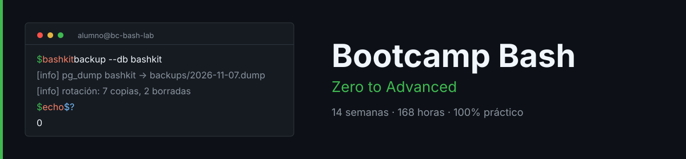

<p align="center">
  
</p>

<p align="center">
  <a href="README.md"></a>
</p>

---

## Overview

A **Zero to Advanced** bootcamp on **Bash**: **14 weeks**, **12 h/week**, **168 hours**, self-paced and 100% hands-on. You start without ever having opened a terminal and finish writing production scripts — tested with bats, clean under shellcheck — that back up PostgreSQL running in Docker.

> All course content is written in **Spanish**. Code identifiers (scripts, functions, variables) are in English.

## Structure

| Phase | Weeks | Hours | Topics |
|---|:--:|:--:|---|
| The terminal | 1-4 | 48h | Filesystem, permissions, processes, redirection, text filters |
| Programming in bash | 5-9 | 60h | Variables, expansions, conditionals, loops, functions, arrays |
| Professional scripts | 10-13 | 48h | sed/awk/jq, robustness, testing, debugging, concurrency |
| Production | 14 | 12h | Capstone with Docker and PostgreSQL |

Each week: minimal theory (1 h), 10 knowledge questions (30 min), 7 labs (7 h) and a weekly increment of the `bashkit` CLI (3.5 h), auto-graded with `checks.json`.

## Quick start

```bash
git clone https://github.com/ergrato-dev/bc-bash.git
cd bc-bash
docker compose build
docker compose run --rm lab
./scripts/verificar-semana.sh --doctor
```

Week index: [bootcamp/README.md](bootcamp/README.md).

## License

[CC BY-NC-SA 4.0](LICENSE).
