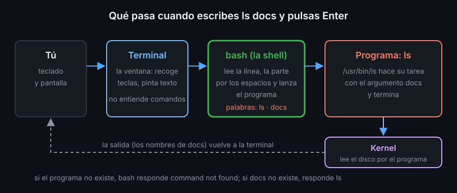
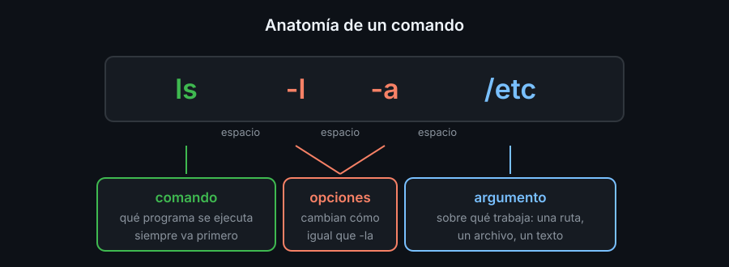

# Terminal, shell y comandos

## Qué hay detrás de la ventana negra

Cuando abres una terminal intervienen tres piezas distintas, aunque las veas como una sola:

- **Terminal**: la ventana. Recoge lo que tecleas y muestra texto. No entiende ningún comando.
- **Shell**: el programa que corre dentro de la terminal. Lee la línea que escribes, la interpreta y lanza el programa que pides. En este bootcamp la shell es **bash** (GNU Bourne-Again Shell), la de casi todos los servidores Linux.
- **Programas**: `ls`, `cp`, `date`... Cada comando es un programa (o una función que bash trae dentro) que hace una sola cosa y termina.



Por qué importa: cuando algo falla, saber qué capa falla te dice dónde buscar. `bash: lss: command not found` lo dice bash (no encontró el programa); `ls: cannot access 'x': No such file or directory` lo dice `ls` (el programa existe, el archivo no).

## El laboratorio

Todo el bootcamp se hace dentro de un contenedor Docker con las mismas versiones para todo el mundo. Desde la raíz del repositorio:

```bash
docker compose run --rm lab
```

Entras en una shell bash del laboratorio. `--rm` borra el contenedor al salir; tus archivos del repositorio no se pierden, porque la carpeta del repositorio está montada dentro en `/bc-bash`.

## El prompt

Lo primero que ves es el **prompt**: el texto con el que bash te dice "estoy esperando una orden".

```text
alumno@bc-bash-lab:/bc-bash$
```

| Parte | Significado |
|---|---|
| `alumno` | tu usuario |
| `bc-bash-lab` | el nombre de la máquina |
| `/bc-bash` | la carpeta en la que estás (el *directorio de trabajo*) |
| `$` | usuario normal; `#` sería el administrador (`root`) |

En este bootcamp, los bloques de código no incluyen el prompt: copias solo el comando. Los bloques `text` son lo que la terminal responde.

## Anatomía de un comando



- El **comando** va primero: el nombre del programa.
- Las **opciones** empiezan por `-` y cambian su comportamiento. Las cortas se pueden juntar: `ls -la` es lo mismo que `ls -l -a`. Las largas usan dos guiones: `ls --all`.
- Los **argumentos** dicen sobre qué trabajar: un archivo, una carpeta, un texto.
- Los **espacios separan** las piezas. `ls-l` es un comando que no existe; `ls -l` es `ls` con la opción `-l`.
- Mayúsculas y minúsculas **no son lo mismo**: `ls -r` y `ls -R` hacen cosas distintas, y `Notas.txt` y `notas.txt` son dos archivos.

Pulsas **Enter** para ejecutar. Mientras un programa corre, el prompt no vuelve; cuando termina, reaparece.

## Teclas de emergencia

| Tecla | Qué hace |
|---|---|
| `Ctrl+C` | interrumpe el programa que está corriendo y te devuelve el prompt |
| `Ctrl+L` o `clear` | limpia la pantalla (no borra nada más) |
| `Ctrl+D` o `exit` | cierra la shell; en el laboratorio, sales del contenedor |
| `q` | sale de programas que ocupan toda la pantalla, como `man` o `less` |

`Ctrl+C` no copia texto en la terminal: interrumpe. Para copiar, selecciona con el ratón y usa el menú (o `Ctrl+Shift+C` en Linux).

<!-- nav -->
---

## 🔗 Navegación

| Anterior | Siguiente |
|---|---|
| ← [Semana 01 — Terminal y sistema de archivos](../README.md) | [Teoría — Sistema de archivos y rutas](02-sistema-de-archivos-y-rutas.md) → |

[↑ Semana 01](../README.md)
