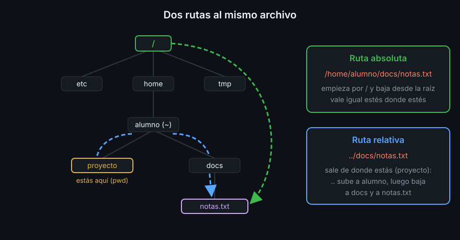

# Sistema de archivos y rutas

## Un solo árbol

En Linux todos los archivos cuelgan de un único árbol. Su raíz se llama `/` (barra). No hay `C:` ni `D:`: un disco nuevo aparece como una carpeta más dentro del árbol.

Una **carpeta** (en la documentación técnica, **directorio**) contiene archivos y otras carpetas. Las que verás a menudo:

| Carpeta | Qué guarda |
|---|---|
| `/` | la raíz: el punto de partida de todo |
| `/home/alumno` | tu carpeta personal (**home**): tus archivos y tu configuración |
| `/etc` | configuración del sistema (texto plano) |
| `/usr/bin` | los programas: `ls`, `cp`, `find`... |
| `/tmp` | archivos temporales; se vacía al reiniciar |
| `/bc-bash` | en el laboratorio, el repositorio del bootcamp |

## El directorio de trabajo

La shell siempre está "dentro" de una carpeta: el **directorio de trabajo**. `pwd` (*print working directory*) lo imprime, y `cd` (*change directory*) lo cambia. Todo nombre de archivo que escribas sin `/` al principio se busca a partir de ahí.

## Rutas absolutas y relativas

Una **ruta** es la dirección de un archivo en el árbol: los nombres de las carpetas por las que pasas, separados por `/`.

- **Absoluta**: empieza por `/`. Se lee desde la raíz y significa lo mismo estés donde estés: `/home/alumno/notas.txt`.
- **Relativa**: no empieza por `/`. Se lee desde el directorio de trabajo: si estás en `/home/alumno`, `notas.txt` y `./notas.txt` son `/home/alumno/notas.txt`.

Tres nombres especiales ayudan a escribir rutas cortas:

| Símbolo | Significa | Ejemplo |
|---|---|---|
| `.` | la carpeta actual | `./scaffold.sh` |
| `..` | la carpeta de arriba (la madre) | `cd ..` |
| `~` | tu home | `cd ~` (o `cd` a secas) |

Y uno de `cd`: `cd -` vuelve a la carpeta en la que estabas antes del último `cd`.

Cuál usar: una ruta absoluta en un script no depende de dónde lo ejecutes, pero se rompe si mueves la carpeta; una relativa sigue valiendo si mueves la carpeta entera. Los labs usan relativas porque cada uno empieza con un `cd` a su carpeta.

## Archivos ocultos

Un nombre que empieza por punto (`.bashrc`, `.gitkeep`) es un **archivo oculto**: `ls` no lo muestra salvo que añadas `-a`. No es seguridad, solo orden: la configuración no estorba al listar.

## Nombres con espacios

`ls Mis Fotos` le pasa **dos** argumentos a `ls`: `Mis` y `Fotos`. Para que bash lo trate como un solo nombre, ponlo entre comillas: `ls "Mis Fotos"`. La tecla `Tab` lo hace por ti (ver [04-ayuda-atajos-e-historial.md](04-ayuda-atajos-e-historial.md)). La semana 05 explica las comillas a fondo.

<!-- nav -->
---

## 🔗 Navegación

| Anterior | Siguiente |
|---|---|
| ← [Teoría — Terminal, shell y comandos](01-terminal-shell-y-comandos.md) | [Teoría — Crear, copiar, mover, borrar y buscar](03-crear-copiar-mover-borrar.md) → |

[↑ Semana 01](../README.md)
