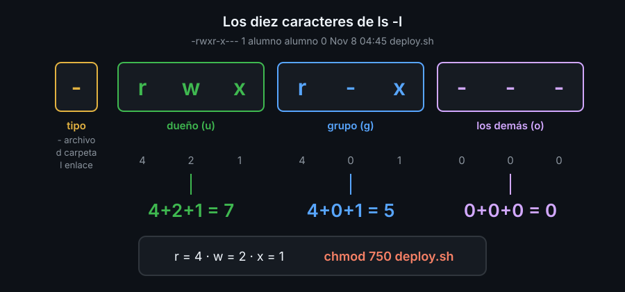

# Usuarios, grupos y permisos

## Quién eres para el sistema

Linux es multiusuario: cada archivo y cada proceso pertenece a un **usuario**. Para el sistema, un usuario es un número, el **uid**; el nombre (`alumno`) solo existe para las personas. Además, cada usuario pertenece a uno o más **grupos** (con su número, el **gid**), y un grupo sirve para dar permisos a varias personas a la vez.

```bash
id
```

```text
uid=1000(alumno) gid=1000(alumno) groups=1000(alumno)
```

Los usuarios se guardan en `/etc/passwd`, una línea por usuario y siete campos separados por `:`:

```text
alumno:x:1000:1000:Alumno bc-bash:/home/alumno:/bin/bash
```

| `alumno` | `x` | `1000` | `1000` | `Alumno bc-bash` | `/home/alumno` | `/bin/bash` |
|---|---|---|---|---|---|---|
| nombre | contraseña: está cifrada en `/etc/shadow` | uid | gid del grupo principal | descripción | home | shell al entrar |

Hay un usuario especial: **root** (uid 0), el administrador. A root no le afectan los permisos: puede leer, cambiar y borrar cualquier archivo. Por eso se trabaja como usuario normal y solo se usa root para lo que lo exige, como crear usuarios o cambiar el dueño de un archivo.

## Leer los permisos

`ls -l` muestra, al principio de cada línea, el tipo de archivo y tres grupos de tres letras:



Cuando accedes a un archivo, el sistema mira **un solo** grupo de letras: el del dueño si eres el dueño; si no, el del grupo si perteneces al grupo; y si no, el de los demás.

Las mismas tres letras significan cosas distintas en un archivo y en una carpeta:

| Letra | En un archivo | En una carpeta |
|---|---|---|
| `r` (*read*) | leer el contenido (`cat`) | ver los nombres de lo que hay dentro (`ls`) |
| `w` (*write*) | cambiar el contenido | crear, renombrar y borrar archivos dentro |
| `x` (*execute*) | ejecutarlo como programa | entrar (`cd`) y llegar a lo que hay dentro |

Por eso, para borrar un archivo no necesitas permiso de escritura en él, sino en la carpeta que lo contiene.

## Cambiar permisos: `chmod`

`chmod` tiene dos formas de decir lo mismo.

**Simbólica**: a quién (`u` dueño, `g` grupo, `o` demás, `a` todos), qué haces (`+` añadir, `-` quitar, `=` dejar exactamente) y qué letras:

```bash
chmod u+x deploy.sh      # el dueño puede ejecutarlo
chmod go-w informe.txt   # grupo y demás ya no pueden escribir
chmod +x deploy.sh       # sin "a quién": todos (salvo lo que impida la umask)
```

**Octal**: un número por grupo, sumando `r`=4, `w`=2, `x`=1. Fija los nueve permisos de una vez:

| Número | Permisos | Uso típico |
|---|---|---|
| `755` | `rwxr-xr-x` | scripts y carpetas que todos pueden usar |
| `644` | `rw-r--r--` | documentos que todos pueden leer |
| `700` | `rwx------` | carpetas privadas |
| `600` | `rw-------` | claves, contraseñas, notas privadas |

La forma simbólica cambia solo lo que nombras; la octal reemplaza todo. Usa la octal cuando sepas el resultado exacto que quieres.

Los archivos nuevos nacen con `644` y las carpetas con `755` porque la **umask** (`022` en el laboratorio) quita la escritura al grupo y a los demás.

## Cambiar el dueño: `chown`

```bash
chown ana informe.txt          # nuevo dueño
chown ana:equipo informe.txt   # nuevo dueño y grupo
chgrp equipo informe.txt       # solo el grupo
```

Solo root puede regalar un archivo a otro usuario. Si no, cualquiera podría dejar un archivo a nombre de otra persona. Como `alumno` verás `Operation not permitted`.

<!-- nav -->
---

## 🔗 Navegación

| Anterior | Siguiente |
|---|---|
| ← [Semana 02 — Permisos, procesos y primer script](../README.md) | [Teoría — Procesos y señales](02-procesos-y-senales.md) → |

[↑ Semana 02](../README.md)
