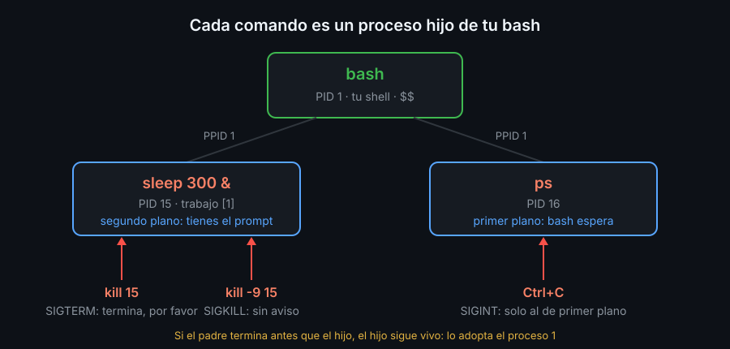

# Procesos y señales

## Programa y proceso

Un **programa** es un archivo en el disco, como `/usr/bin/sleep`. Un **proceso** es ese programa en marcha: tiene memoria, un directorio de trabajo, sus variables y un dueño. Si ejecutas `sleep` tres veces a la vez, hay un programa y tres procesos.

Cada proceso tiene un número único, el **PID**, y recuerda qué proceso lo creó, su **PPID** (*parent PID*). Cuando escribes un comando, bash crea un proceso hijo que ejecuta el programa, así que todos los procesos forman un árbol:



`$$` es el PID del bash en el que estás: `echo $$`.

## Verlos: `ps`

| Comando | Qué muestra |
|---|---|
| `ps` | los procesos de tu terminal |
| `ps -f` | lo mismo, con dueño, PPID y el comando completo |
| `ps -e` | todos los procesos del sistema |
| `ps -o pid,ppid,stat,comm` | solo las columnas que elijas |
| `pstree -p` | el árbol, con los PID entre paréntesis |

La columna `STAT` dice qué hace el proceso: `R` está ejecutándose, `S` duerme esperando algo (tiempo, teclado, disco) y `T` está detenido.

## Primer y segundo plano

Normalmente bash espera a que el comando termine antes de devolverte el prompt: está en **primer plano**. Con `&` al final, lo lanza en **segundo plano** y te devuelve el prompt enseguida:

```bash
sleep 300 &
```

```text
[1] 15
```

`[1]` es el número de **trabajo** (*job*) para esta shell; `15` es el PID para todo el sistema. Para manejar trabajos:

| Acción | Qué hace |
|---|---|
| `jobs` | lista los trabajos de esta shell |
| `Ctrl+Z` | detiene el de primer plano (queda `Stopped`) |
| `bg` | reanuda el detenido, en segundo plano |
| `fg` | lo trae a primer plano |
| `kill %1` | manda una señal al trabajo `1` |

Los trabajos son de tu shell: si cierras la terminal, terminan con ella.

## Señales: `kill`

Una **señal** es un aviso que el sistema entrega a un proceso. `kill` no siempre mata: manda la señal que le pidas, y por defecto pide terminar.

| Señal | Número | Cómo se manda | Qué significa |
|---|---|---|---|
| `SIGINT` | 2 | `Ctrl+C` | interrumpe lo que hay en primer plano |
| `SIGTERM` | 15 | `kill PID` | termina, por favor: el programa puede limpiar antes |
| `SIGKILL` | 9 | `kill -9 PID` | el sistema lo elimina sin avisarle; no puede limpiar |
| `SIGTSTP` | 20 | `Ctrl+Z` | pausa el proceso hasta que `fg` o `bg` lo reanuden |

Usa `kill PID` primero. `kill -9` es el último recurso: el programa no tiene ocasión de borrar sus archivos temporales ni de guardar lo pendiente.

Solo puedes mandar señales a tus propios procesos. Los de otros usuarios necesitan root.

Cuando un proceso termina por una señal, su código de salida es 128 más el número de la señal: tras `Ctrl+C`, `echo $?` imprime `130` (128 + 2). Los códigos de salida se ven a fondo en la semana 03.

## Huérfanos

Si un padre termina antes que su hijo, el hijo no muere: pasa a ser hijo del proceso 1 (en el laboratorio, el bash con el que entraste). En el lab 05 lo verás con un `sleep` que su script no paró.

<!-- nav -->
---

## 🔗 Navegación

| Anterior | Siguiente |
|---|---|
| ← [Teoría — Usuarios, grupos y permisos](01-usuarios-grupos-y-permisos.md) | [Teoría — Scripts y shebang](03-scripts-y-shebang.md) → |

[↑ Semana 02](../README.md)
