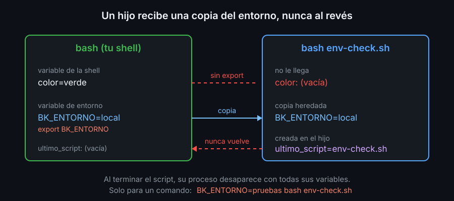
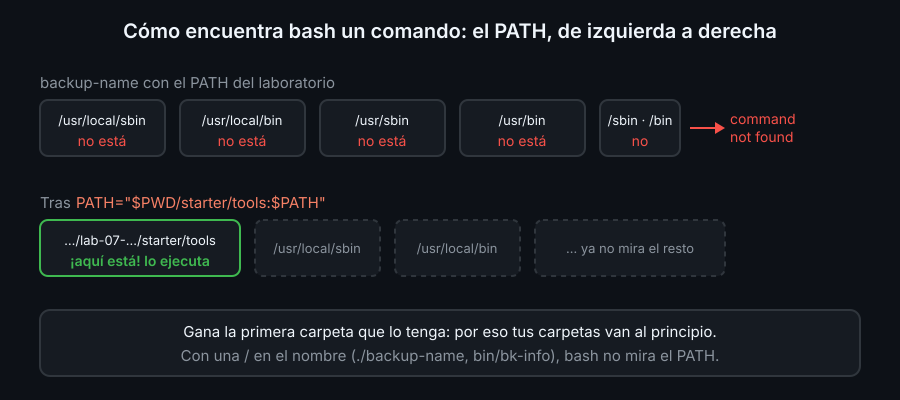

# PATH y variables de entorno

## Variables

Una **variable** es un nombre que guarda un texto. Se crea con `nombre=valor`, **sin espacios** alrededor del `=`, y se lee con `$nombre`:

```bash
color=verde
echo "el color es $color"
```

```text
el color es verde
```

Con espacios (`color = verde`) bash entiende que quieres ejecutar un comando llamado `color` y responde `command not found`. Una variable que no existe vale texto vacío, sin error. `unset color` la borra.

Por convención, las variables de tus scripts van en minúsculas (`color`, `ultimo_script`) y las de entorno en mayúsculas (`HOME`, `PATH`).

## Variables de entorno

Cada proceso tiene su propia copia de un conjunto de variables, su **entorno**. Cuando un proceso crea un hijo, el hijo recibe una **copia** del entorno del padre. Algunas que ya tienes:

| Variable | Qué guarda |
|---|---|
| `HOME` | tu carpeta personal; `cd` sin argumentos te lleva ahí |
| `PATH` | las carpetas donde bash busca los programas |
| `PWD` | el directorio de trabajo actual |
| `HOSTNAME` | el nombre del equipo |
| `BASH_VERSION` | la versión de bash (solo existe dentro de bash) |

`env` o `printenv` muestran el entorno; `printenv HOME` muestra una sola variable.

## `export`: qué ven los hijos

Una variable que creas con `color=verde` es **de la shell**: la usas tú, pero los programas que lanzas no la reciben. `export` la pasa al entorno, y desde ese momento todos los hijos la heredan:



```bash
export color             # una que ya existía
export BK_ENTORNO=local  # crear y exportar a la vez
BK_ENTORNO=pruebas ./script.sh   # solo para este comando, sin tocar la shell
```

La herencia va en un solo sentido: un hijo recibe copias y nunca puede cambiar las variables de su padre.

Todo esto dura lo que dure la shell. Al salir del laboratorio (`exit`), se pierde.

## `PATH`: dónde buscar los comandos

Cuando escribes `ls`, bash no busca en la carpeta actual. Recorre las carpetas de `PATH`, separadas por `:`, en orden, y ejecuta el primer `ls` que encuentra:



Si el nombre lleva una `/` (`./script.sh`, `bin/bk-info`), bash no mira el `PATH`: usa esa ruta tal cual.

Para que tus scripts funcionen por su nombre, añade su carpeta al `PATH`:

```bash
PATH="$PWD/bin:$PATH"
```

`$PWD/bin` es una ruta absoluta (si pusieras `bin` a secas, solo funcionaría desde esa carpeta). Va **al principio** para que gane a cualquier comando del sistema con el mismo nombre; al final, perdería. `PATH` ya está exportada, así que los hijos también ven el cambio.

Para preguntar qué ejecutará bash:

```bash
type backup-name     # qué es y dónde está (lo viste en la semana 01)
command -v backup-name   # solo la ruta, útil dentro de scripts
```

Nunca pongas `.` (la carpeta actual) en el `PATH`: cualquier carpeta en la que entres podría tener un archivo llamado `ls` que harías ejecutar sin darte cuenta.

<!-- nav -->
---

## 🔗 Navegación

| Anterior | Siguiente |
|---|---|
| ← [Teoría — Scripts y shebang](03-scripts-y-shebang.md) | [Índice de labs](../2-practicas/README.md) → |

[↑ Semana 02](../README.md)
