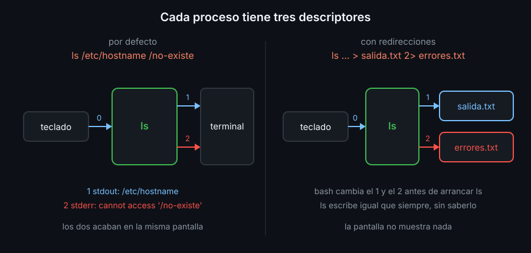
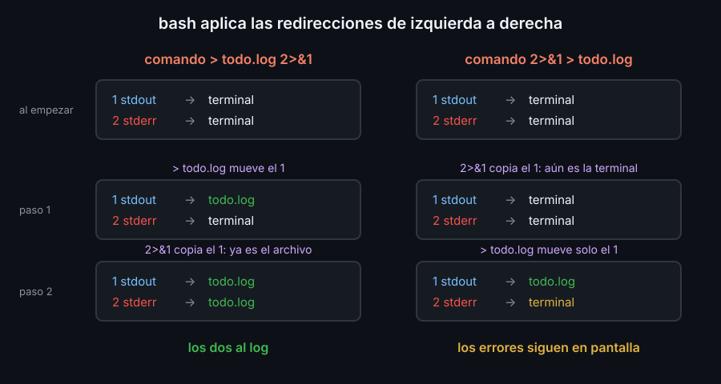

# Redirección y descriptores

## Tres canales por proceso

Cada proceso nace con tres canales abiertos, numerados. A cada número se le llama **descriptor de archivo**:

| Descriptor | Nombre | Para qué | Por defecto |
|:--:|---|---|---|
| 0 | stdin | lo que el programa lee | el teclado |
| 1 | stdout | sus resultados | la terminal |
| 2 | stderr | sus errores y avisos | la terminal |



Como stdout y stderr acaban en la misma pantalla, parecen lo mismo. No lo son, y eso es justo lo que permite separar los resultados de los errores:

```bash
ls /etc/hostname /no-existe
```

```text
/etc/hostname
ls: cannot access '/no-existe': No such file or directory
```

La primera línea salió por el 1 y la segunda por el 2.

## Redirigir: cambiar adónde apunta un descriptor

Antes de arrancar un comando, bash lee sus redirecciones y cambia los descriptores. El programa no se entera: escribe en su 1 como siempre, y su 1 ahora es un archivo.

| Escribes | Qué hace |
|---|---|
| `> f` | stdout a `f`; lo vacía antes (es lo mismo que `1> f`) |
| `>> f` | stdout al final de `f`, sin vaciarlo |
| `2> f` | stderr a `f` |
| `2>> f` | stderr al final de `f` |
| `&> f` | stdout y stderr a `f` (atajo de bash) |
| `< f` | stdin desde `f` |
| `2>&1` | el 2 apunta adonde apunte el 1 **en ese momento** |
| `>&2` | stdout adonde apunte el 2: escribir un mensaje de error |

Si `f` no existe, `>` y `>>` lo crean. Si existe, `>` lo vacía **antes** de que el comando lea nada, así que `sort f > f` deja `f` vacío.

## `/dev/null`

`/dev/null` es un dispositivo que acepta todo lo que se le escribe y lo tira. Leerlo no da nada:

```bash
find /etc/ssl -type f 2> /dev/null
```

Así se callan los avisos de las carpetas que no puedes leer, sin perder la lista. Úsalo con criterio: un error que tiras es un error que no vas a ver.

## El orden importa

bash aplica las redirecciones **de izquierda a derecha**, y `2>&1` copia el destino del 1 en ese instante. No es un enlace: si después mueves el 1, el 2 se queda donde estaba.



```bash
comando > todo.log 2>&1     # los dos al log
comando 2>&1 > todo.log     # solo stdout al log; stderr sigue en pantalla
```

Para mandar los dos a un archivo, la forma que funciona en cualquier shell es la primera. `&> todo.log` hace lo mismo, pero solo en bash.

## Mensajes para la persona: siempre a stderr

Un script bien hecho escribe sus resultados por stdout y todo lo demás (errores, avisos, progreso) por stderr:

```bash
echo "uso: bk-run <comando>" >&2
```

Así quien lo ejecute puede guardar o encadenar los resultados (`> datos.txt`, `| wc -l`) sin que se le cuelen los mensajes, y a la vez seguir viéndolos en pantalla.

## `noclobber`

`set -o noclobber` hace que `>` se niegue a pisar un archivo que ya existe. `>|` lo fuerza cuando de verdad quieres hacerlo. Es una red de seguridad para tu shell interactiva; en scripts se prefiere comprobar antes (semana 06).

<!-- nav -->
---

## 🔗 Navegación

| Anterior | Siguiente |
|---|---|
| ← [Semana 03 — Redirección, pipes y códigos de salida](../README.md) | [Teoría — Pipes, tee y here-docs](02-pipes-tee-y-here-docs.md) → |

[↑ Semana 03](../README.md)
