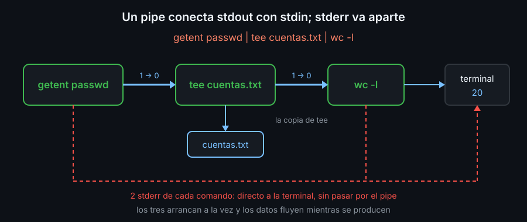

# Pipes, tee y here-docs

## Pipes: la salida de uno es la entrada del otro

```bash
getent passwd | sort | head -3
```

El `|` (pipe) conecta el stdout del comando de la izquierda con el stdin del de la derecha. Cada comando hace una sola cosa: `getent` saca las cuentas, `sort` las ordena y `head` deja pasar las 3 primeras. Juntos responden a una pregunta que ninguno responde solo.



Tres detalles que explican casi todos los sustos:

- **Todos arrancan a la vez.** No espera uno a que termine el otro: los datos fluyen mientras se producen. Por eso un pipe funciona con archivos enormes.
- **stderr no entra en el pipe.** Los errores de la izquierda salen directos a la pantalla. Para meterlos, `2>&1 |` o su atajo `|&`.
- **El código del pipe es el del último comando.** En `ls /no-existe | wc -l`, `ls` falla, `wc` cuenta 0 y el pipe sale con `0`. `set -o pipefail` lo cambia ([04](04-set-euo-pipefail.md)).

## `tee`: guardar sin cortar

`tee archivo` copia su stdin al archivo **y** a su stdout. Va en medio de un pipe para guardar lo que pasa sin detenerlo:

```bash
getent passwd | tee cuentas.txt | wc -l
```

`tee -a` añade en vez de vaciar, como `>>`. Si solo quieres la copia en el archivo, manda su stdout a `/dev/null`.

## Here-docs: varias líneas como entrada

Un **here-doc** mete en el stdin de un comando las líneas que siguen, hasta una que diga exactamente la palabra de cierre:

```bash
cat > app.conf <<EOF
usuario=$(id -un)
creado=$(date '+%F')
EOF
```

Hay dos redirecciones: `<<EOF` alimenta el stdin de `cat` y `> app.conf` guarda su stdout. Es la forma más clara de que un script genere un archivo de varias líneas.

| Forma | Dentro del texto |
|---|---|
| `<<EOF` | bash sustituye `$VAR` y `$( )`, como entre comillas dobles |
| `<<'EOF'` | nada se sustituye, como entre comillas simples |

La palabra de cierre tiene que estar sola en su línea, sin espacios delante ni detrás. `EOF` es costumbre; vale cualquier palabra.

## Here-strings: un solo texto

`<<<` hace lo mismo con un único texto, sin archivo ni `echo`:

```bash
wc -w <<< "uno dos tres"
```

Pon siempre el texto entre comillas: sin ellas, `<<<` solo se lleva la primera palabra y el resto pasan a ser argumentos del comando.

<!-- nav -->
---

## 🔗 Navegación

| Anterior | Siguiente |
|---|---|
| ← [Teoría — Redirección y descriptores](01-redireccion-y-descriptores.md) | [Teoría — Códigos de salida](03-codigos-de-salida.md) → |

[↑ Semana 03](../README.md)
