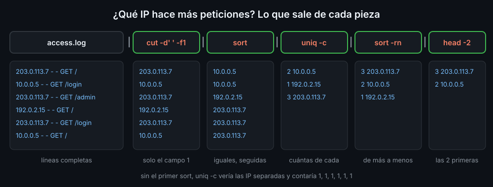

# Cortar, transformar, ordenar y contar

## cut: elegir columnas

Muchos archivos son tablas: cada línea es un registro y un carácter separa los campos. En `/etc/passwd` el separador es `:` y el campo 7 es la shell de cada cuenta.

```bash
cut -d: -f1,7 /etc/passwd | head -3
```

```text
root:/bin/bash
daemon:/usr/sbin/nologin
bin:/usr/sbin/nologin
```

| Opción | Qué hace |
|---|---|
| `-d:` | el separador es `:` (un solo carácter); sin `-d`, el tabulador |
| `-f1,7` | los campos 1 y 7; `-f2-4`, del 2 al 4; `-f3-`, del 3 al final |
| `-c1-8` | los caracteres 1 a 8 de cada línea, sin mirar separadores |

`cut` cuenta **cada** separador. Si hay dos espacios seguidos, entre ellos hay un campo vacío, y la columna que buscas ya no está donde esperas. Por eso, antes de cortar por espacios, se juntan con `tr -s ' '`.

## tr: cambiar caracteres

`tr` (*translate*) cambia caracteres uno a uno. Solo lee de stdin: no acepta nombres de archivo.

| Escribes | Hace |
|---|---|
| `tr a-z A-Z` | minúsculas a mayúsculas; `tr '[:lower:]' '[:upper:]'` es lo mismo con nombre de clase |
| `tr ',' '\n'` | cada coma, un salto de línea |
| `tr -d '\r'` | borra los `\r` (los finales de línea de Windows) |
| `tr -s ' '` | junta los espacios repetidos en uno |

```bash
echo 'a   b    c' | tr -s ' '
```

```text
a b c
```

## sort: ordenar

`sort` ordena líneas como texto, carácter a carácter. Con números, eso da sorpresas: `100` va antes que `9` porque `1` va antes que `9`.

| Opción | Qué cambia |
|---|---|
| `-n` | compara como número: 9, 10, 100 |
| `-r` | al revés, de mayor a menor |
| `-t: -k3` | separador `:`, ordena por el campo 3 |
| `-u` | quita las líneas repetidas |

`-k3` ordena desde el campo 3 hasta el final de la línea; `-k3,3`, solo por el campo 3. Se combinan: `sort -t: -k3,3n` ordena `/etc/passwd` por su UID como número.

## uniq: juntar repetidas

`uniq` junta las líneas iguales **seguidas**; con `-c`, pone delante cuántas eran. Si las repetidas no están juntas, no las ve:

```bash
printf 'b\na\nb\nb\na\n' | uniq -c
printf 'b\na\nb\nb\na\n' | sort | uniq -c
```

```text
      1 b
      1 a
      2 b
      1 a
      2 a
      3 b
```

Por eso `uniq` casi siempre va detrás de `sort`. `printf 'b\na\n'` escribe una línea por cada `\n`: lo verás a fondo en la semana 09.

## La receta: ¿qué se repite más?

Estas piezas forman la cadena más usada en administración de sistemas. Para contar qué shell usan las cuentas:

```bash
cut -d: -f7 /etc/passwd | sort | uniq -c | sort -rn
```

```text
     17 /usr/sbin/nologin
      2 /bin/bash
      1 /bin/sync
```



Cambia el `cut` por lo que quieras contar (IP, códigos de estado, URL, usuarios) y la cadena sirve igual. Añade `head -n N` al final para quedarte con los N primeros.

<!-- nav -->
---

## 🔗 Navegación

| Anterior | Siguiente |
|---|---|
| ← [Teoría — grep y expresiones regulares](02-grep-y-expresiones-regulares.md) | [Teoría — Buscar archivos con find](04-buscar-archivos-con-find.md) → |

[↑ Semana 04](../README.md)
