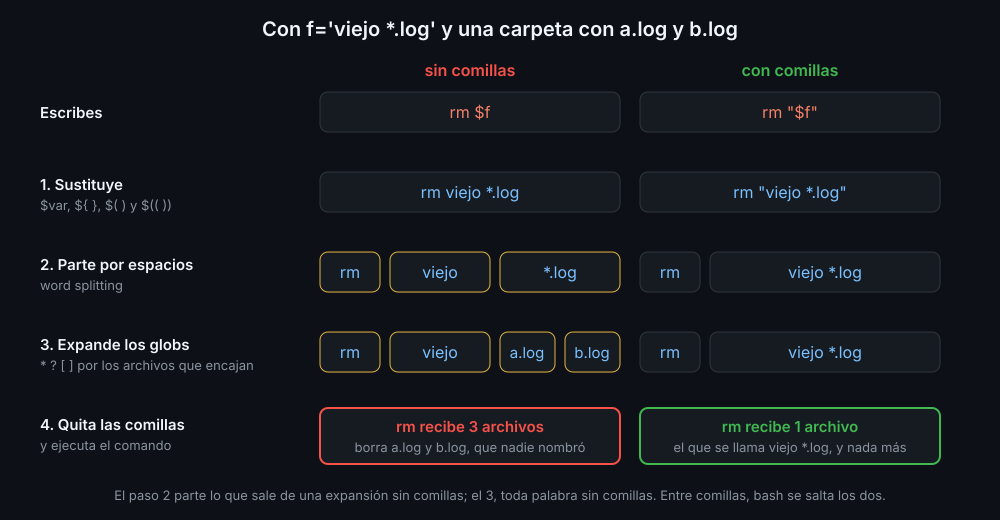

# Word splitting y globbing

## Qué hace bash antes de ejecutar

Entre que escribes una línea y el comando arranca, bash la transforma en este orden:

1. **Sustituye** las expansiones: `$var`, `${ }`, `$( )` y `$(( ))`.
2. **Parte en palabras** lo que salió de una expansión sin comillas (*word splitting*).
3. **Expande los globs**: cambia cada palabra sin comillas que tenga `*`, `?` o `[ ]` por los archivos que encajan.
4. **Quita las comillas** y ejecuta el comando con las palabras que quedan.



Los pasos 2 y 3 son los que convierten una variable sin comillas en un peligro: el comando no recibe el valor, sino lo que bash hizo con él.

## Word splitting

Tras sustituir una variable sin comillas, bash parte su valor por los espacios, tabuladores y saltos de línea. Cada trozo es un argumento distinto, y los separadores repetidos desaparecen.

```bash
f="informe final.txt"
printf '[%s]\n' $f
printf '[%s]\n' "$f"
```

```text
[informe]
[final.txt]
[informe final.txt]
```

`printf '[%s]\n'` imprime cada argumento que recibe entre corchetes: es la forma de ver qué le llega a un comando. Sin comillas, `$f` son dos argumentos; con comillas, uno.

La salida de `$( )` se parte igual: `echo $(ls)` pone todos los nombres en una línea, porque los saltos de línea también separan.

## Globbing

Un **glob** es un patrón de nombres de archivo. bash lo cambia por la lista ordenada de los que encajan **antes** de ejecutar el comando, que nunca ve el patrón.

| Patrón | Encaja con | Ejemplo |
|---|---|---|
| `*` | cualquier texto, también vacío | `*.log`: todo lo que acaba en `.log` |
| `?` | un carácter, cualquiera | `foto?.jpg`: `foto1.jpg`, `fotoA.jpg` |
| `[abc]` | uno de esos caracteres | `[0-9]*`: lo que empieza por cifra |
| `[^abc]` o `[!abc]` | uno que **no** sea de esos | `[^.]*`: lo que no empieza por punto |

Tres detalles que sorprenden:

- **Si nada encaja, el patrón se queda tal cual.** `ls *.pdf` en una carpeta sin PDF le pasa a `ls` el texto `*.pdf`, y `ls` dice que no existe.
- **`*` no encaja con los archivos ocultos** (los que empiezan por `.`), salvo que el patrón empiece por punto: `.*`.
- **Entre comillas no hay globbing.** `echo "*"` imprime un asterisco.

Un glob no es una regex (semana 04): en una regex, `*` es "lo anterior, cero o más veces"; en un glob, "cualquier texto".

## Nombres que empiezan por `-`

Un glob puede producir un nombre que el comando confunda con una opción: si existe `-f.tmp`, `rm *.tmp` recibe `-f.tmp` y lo interpreta como opciones. `--` marca el final de las opciones: todo lo que va detrás es un argumento, empiece por lo que empiece.

```bash
rm -- *.tmp
mv -- "$origen" "$destino"
```

Las dos defensas juntas: comillas dobles en toda expansión y `--` delante de los nombres que no controlas.

<!-- nav -->
---

## 🔗 Navegación

| Anterior | Siguiente |
|---|---|
| ← [Teoría — Variables y comillas](01-variables-y-comillas.md) | [Teoría — Expansiones de parámetros](03-expansiones-de-parametros.md) → |

[↑ Semana 05](../README.md)
