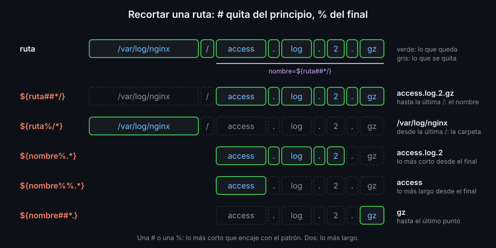

# Expansiones de parámetros

`$var` es la forma corta de `${var}`. Entre las llaves caben operadores que transforman el valor al sustituirlo, sin cambiar la variable y sin lanzar ningún programa. Son la navaja suiza de bash: valores por defecto, recortes, sustituciones y mayúsculas.

## Valores por defecto

| Escribes | Vale | Si `var` no existe o está vacía |
|---|---|---|
| `${var:-texto}` | `$var` | `texto`; la variable no cambia |
| `${var:=texto}` | `$var` | `texto`, y además lo guarda en `var` |
| `${var:?mensaje}` | `$var` | escribe el mensaje en stderr y para el script |
| `${var:+texto}` | `texto` si `var` tiene algo | vacío |

```bash
puerto="${DB_PORT:-5432}"
usuario="${DB_USER:?falta DB_USER}"
echo "conectando${DEBUG:+ (modo debug)}"
```

Sin los dos puntos (`${var-texto}`), solo cuenta si la variable existe: una vacía se usa tal cual. Casi siempre quieres los dos puntos.

Con `set -u`, `${var:-}` (por defecto, vacío) es la forma de leer una variable que puede no existir sin parar el script. Ya lo usaste en `bk-top-ips`: `top="${2:-10}"`.

## Longitud y trozos

| Escribes | Con `f=2026-11-08` | Qué hace |
|---|---|---|
| `${#f}` | `10` | número de caracteres |
| `${f:0:4}` | `2026` | desde la posición 0, 4 caracteres |
| `${f:5}` | `11-08` | desde la posición 5 hasta el final |
| `${f: -2}` | `08` | los 2 últimos; el espacio es obligatorio |

## Recortar

Quitan del principio (`#`) o del final (`%`) lo que encaje con un patrón glob (teoría 02). Con un símbolo, lo más corto que encaje; con dos, lo más largo.



| Escribes | Con `ruta=/var/log/app.tar.gz` |
|---|---|
| `${ruta##*/}` | `app.tar.gz`: el nombre del archivo |
| `${ruta%/*}` | `/var/log`: la carpeta |
| `${ruta%.*}` | `/var/log/app.tar`: sin la última extensión |
| `${ruta%%.*}` | `/var/log/app`: sin ninguna extensión |
| `${ruta##*.}` | `gz`: la última extensión |

Hacen lo mismo que `basename` y `dirname`, sin lanzar un programa. Si el patrón no encaja, el valor queda entero: `${f%/*}` de `notas.txt` es `notas.txt`.

## Sustituir

| Escribes | Con `f="Mi Foto (1).JPG"` |
|---|---|
| `${f/ /-}` | `Mi-Foto (1).JPG`: solo la primera |
| `${f// /-}` | `Mi-Foto-(1).JPG`: todas |
| `${f//[()]/}` | `Mi Foto 1.JPG`: texto vacío, borra |
| `${f/#Mi/Tu}` | `Tu Foto (1).JPG`: solo si está al principio |
| `${f/%.JPG/.jpg}` | `Mi Foto (1).jpg`: solo si está al final |

El patrón también es un glob: `[()]` es "un paréntesis, abierto o cerrado", y `[^a-z]` es "cualquier carácter que no sea una minúscula".

## Mayúsculas y minúsculas

| Escribes | Con `c=sevilla` |
|---|---|
| `${c^}` | `Sevilla` |
| `${c^^}` | `SEVILLA` |
| `${c,,}` | todo en minúsculas |

A diferencia de `tr` (semana 04), funcionan con letras con tilde y con la `ñ`.

## Citar también aquí

Una expansión con operador se cita igual que `$var`: `"${ruta##*/}"`. Si el patrón sale de otra variable, cítala también dentro, para que sus caracteres cuenten tal cual y no como glob: `"${ruta%"$nombre"}"`.

<!-- nav -->
---

## 🔗 Navegación

| Anterior | Siguiente |
|---|---|
| ← [Teoría — Word splitting y globbing](02-word-splitting-y-globbing.md) | [Teoría — Aritmética y sustitución de comandos](04-aritmetica-y-sustitucion-de-comandos.md) → |

[↑ Semana 05](../README.md)
