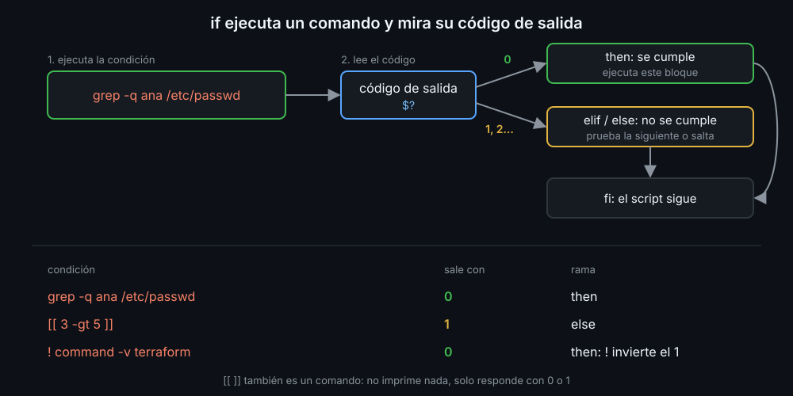

# if y códigos de salida

Hasta ahora tus scripts hacían siempre lo mismo, de arriba abajo. Con `if` deciden: hacen una cosa u otra según lo que encuentran. La idea clave de esta semana cabe en una frase: **`if` no compara nada, ejecuta un comando y mira su código de salida**.

## La forma

```bash
if comando; then
  # si el comando sale con 0
elif otro_comando; then
  # si el primero falló y este sale con 0
else
  # si ninguno salió con 0
fi
```

`then` abre cada bloque y `fi` (`if` al revés) cierra el conjunto. `elif` y `else` son opcionales. bash prueba las condiciones en orden y ejecuta **solo** el primer bloque que se cumple.



## Cualquier comando es una condición

El código de salida (semana 03) es la respuesta: `0` es "sí", cualquier otro es "no".

```bash
if grep -q alumno /etc/passwd; then
  echo "el usuario existe"
fi

if ! ruta=$(command -v git); then
  echo "falta git" >&2
  exit 1
fi
```

`!` invierte el código. Una asignación con `$( )` sale con el código del comando de dentro, así que guardas y decides en la misma línea.

## `[`, `test` y `[[`

Para comparar textos, números o mirar archivos hace falta un comando que lo haga y responda con su código. Hay tres:

| Comando | Qué es |
|---|---|
| `test 3 -gt 2` | el comando clásico de POSIX |
| `[ 3 -gt 2 ]` | el mismo `test`, con otro nombre; el último argumento tiene que ser `]` |
| `[[ 3 -gt 2 ]]` | sintaxis propia de bash: no parte variables ni lee `>` como redirección |

`[` es un comando como `ls`: los espacios dentro de los corchetes separan sus argumentos, y por eso son obligatorios. `[3 -gt 2]` busca un comando llamado `[3`.

En este bootcamp usas siempre `[[ ]]` (teoría 02). Verás `[ ]` en scripts antiguos y en los que tienen que funcionar con `sh`.

## `if` o `&&`

Para una sola acción, `&&` y `||` (semana 03) dicen lo mismo con menos líneas:

```bash
[[ -d zona ]] || mkdir zona
```

En cuanto hay dos acciones, un `else` o un mensaje de error, `if` se lee mejor y no tiene sorpresas: `a && b || c` ejecuta `c` también si falla `b`.

## `set -e` y las condiciones

Un comando que falla dentro de la condición de un `if`, `while`, `&&` o `||` no para el script con `set -e`: es una respuesta, no un error. Por eso `if grep -q ...` funciona aunque `grep` no encuentre nada. La semana 11 explica sus otros límites.

## Códigos de salida de tus scripts

Igual que los comandos que usas, tus scripts responden con su código, y otros scripts los usarán en un `if`. La convención del kit:

| Código | Cuándo |
|---|---|
| `0` | todo bien, o la respuesta es "sí" |
| `1` | la respuesta es "no", o algo falló |
| `2` | se usó mal: faltan argumentos o sobran |

<!-- nav -->
---

## 🔗 Navegación

| Anterior | Siguiente |
|---|---|
| ← [Semana 06 — Condicionales, case y regex](../README.md) | [Teoría — Comparar con `[[ ]]`](02-comparar-con-dobles-corchetes.md) → |

[↑ Semana 06](../README.md)
