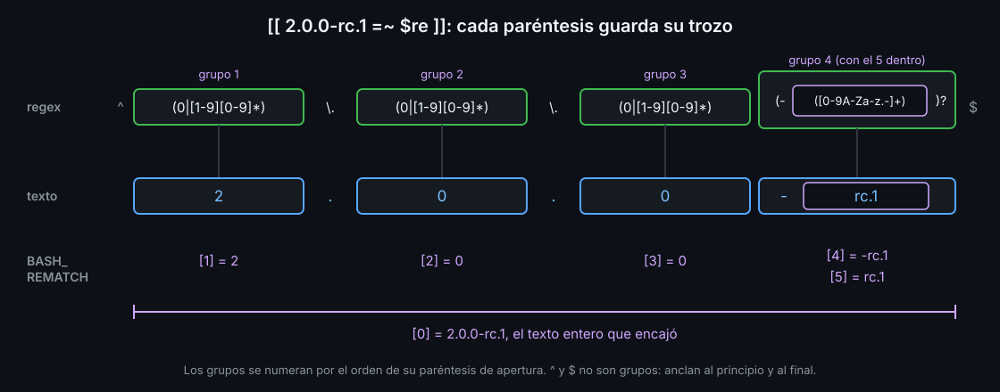

# Regex con `=~` y argumentos

## `=~`: un formato, sin `grep`

`[[ texto =~ regex ]]` sale con `0` si el texto encaja con la regex. Es la regex extendida de `grep -E` (semana 04), sin lanzar ningún programa.

```bash
re='^[0-9]{4}-[0-9]{2}-[0-9]{2}$'
if [[ $fecha =~ $re ]]; then
  echo "parece una fecha"
fi
```

Tres reglas:

1. **Ancla con `^` y `$`.** Sin ellas, basta con que un trozo encaje: `x2026-11-08y` también "parece una fecha".
2. **La regex va en una variable, con comillas simples.** Escrita directamente dentro de `[[ ]]`, sus paréntesis, `|` y espacios se mezclan con la sintaxis de bash.
3. **Detrás de `=~`, sin comillas.** `[[ $f =~ "$re" ]]` busca el **texto** de la regex, con sus corchetes, y casi nunca encaja. shellcheck lo marca como `SC2076`.

## `BASH_REMATCH`: las partes

Cada paréntesis de la regex es un grupo. Cuando `=~` encaja, bash guarda en la lista `BASH_REMATCH` el texto entero y lo que encajó con cada grupo, numerados por el orden de su `(`:

```bash
re='^(0|[1-9][0-9]*)\.(0|[1-9][0-9]*)\.(0|[1-9][0-9]*)(-([0-9A-Za-z.-]+))?$'
[[ 2.0.0-rc.1 =~ $re ]]
echo "${BASH_REMATCH[1]}"   # 2
echo "${BASH_REMATCH[5]}"   # rc.1
```



Si no encaja, `BASH_REMATCH` se vacía, y el siguiente `=~` lo sobrescribe: léelo justo después. Lo que guarda es texto: `08` en una cuenta necesita `10#` (semana 05).

## Argumentos

Lo que escribes detrás del nombre de un script llega en variables especiales:

| Variable | Qué tiene |
|---|---|
| `$0` | el nombre con el que se llamó al script |
| `$1`, `$2`... `${10}` | cada argumento; del 10 en adelante, con llaves |
| `$#` | cuántos argumentos hay |
| `"$@"` | todos, cada uno como llegó: con `"a b" c`, dos argumentos |
| `"$*"` | todos unidos en un solo texto, con espacios |

```bash
if [[ $# -ne 2 ]]; then
  echo "uso: bk-check <tipo> <valor>" >&2
  exit 2
fi
```

Para pasar los argumentos a otro comando, siempre `"$@"`, con comillas: `$@` y `$*` sin ellas los juntan y los vuelven a partir por los espacios (semana 05).

Con `set -u`, leer `$1` cuando no hay argumentos para el script. Si puede faltar, `${1:-}` (semana 05).

## Opciones con `shift`

`shift` quita el primer argumento: `$2` pasa a ser `$1`, y `$#` baja en uno. Con un `case` (teoría 03) lees una opción y te quedas con el resto:

```bash
verbose=""
case "${1:-}" in
  -v)
    verbose=1
    shift
    ;;
esac
touch -- "$@"
```

Con muchas opciones, en cualquier orden, esto crece mal: la semana 11 enseña `getopts`.

<!-- nav -->
---

## 🔗 Navegación

| Anterior | Siguiente |
|---|---|
| ← [Teoría — case](03-case.md) | [Índice de labs](../2-practicas/README.md) → |

[↑ Semana 06](../README.md)
