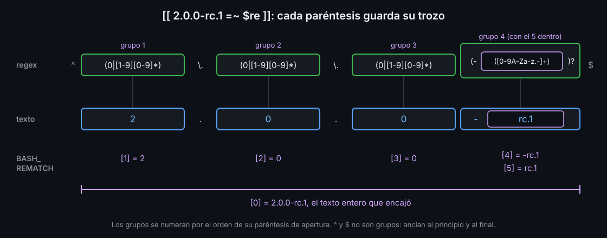

# Proyecto Semana 06 — bk-check: validar antes de usar

⏱ Duración estimada: ~3 h 30 min

## Contexto

Un script que recibe una IP, un email o un número de versión desde fuera (un argumento, un archivo de configuración, una variable de entorno) no puede fiarse de él. Si `10.0.0.300` llega hasta un `ssh` o `1.2` hasta una etiqueta de git, el error aparece mucho después y lejos de su causa. Escribes **`bk-check`**, el quinto comando de `bashkit` ([docs/proyecto-hilo-conductor.md](../../../docs/proyecto-hilo-conductor.md)): recibe un tipo y un valor, y dice si el valor tiene el formato correcto.

```text
$ bk-check ip 192.168.1.10
ok: 192.168.1.10
$ bk-check ip 10.0.0.300
bk-check: '10.0.0.300' no es una IP válida
$ bk-check semver 2.0.0-rc.1
ok: 2.0.0-rc.1 (mayor 2, menor 0, parche 0, prerelease rc.1)
```

Como sale con `0` o con `1`, otros scripts pueden usarlo en un `if`: `if bk-check ip "$host"; then ...`. Lo construyes con `case`, `[[ ]]`, `=~` y `BASH_REMATCH`, sin ningún programa externo.

## Estructura del proyecto

`starter/` es el `bashkit` con el que terminaste la semana 05, más lo nuevo:

```text
3-proyecto/
└── starter/                 ← aquí trabajas (lo corrige el autograding)
    ├── README.md            ← fila de bk-check y bitácora de la semana 06 (TODOs)
    ├── scaffold.sh
    ├── bin/
    │   ├── .gitkeep
    │   ├── bk-info
    │   ├── bk-run
    │   ├── bk-top-ips
    │   ├── bk-rename
    │   └── bk-check         ← nuevo: sin permiso de ejecución (TODOs 1 a 8)
    ├── lib/.gitkeep
    ├── tests/.gitkeep
    └── docs/
        ├── mapa.txt
        └── inventario.txt   ← hay que regenerarlo
```

## Lo que debes construir

1. `bin/bk-check` con permisos `755`. Uso: `bk-check <ip|email|semver> <valor>`.
2. Con `-h` o `--help`, el uso en stdout y código `0`. Con un número de argumentos distinto de 2, el uso en stderr y código `2`.
3. Con un tipo que no sea `ip`, `email` ni `semver`, un aviso en stderr con el tipo y código `2`.
4. `ip`: cuatro números de 0 a 255 separados por puntos, sin ceros a la izquierda.
5. `email`: algo antes de una sola `@`, y después un dominio con al menos un punto y una terminación de dos letras o más.
6. `semver`: `MAYOR.MENOR.PARCHE`, sin ceros a la izquierda, con un `-prerelease` opcional.
7. Si el valor es válido, `ok: <valor>` en stdout y código `0`; con `semver`, además, sus partes. Si no, un aviso en stderr y código `1`.
8. Todos los scripts del kit sin TODOs y sin avisos de shellcheck; `docs/inventario.txt` regenerado y `README.md` sin TODOs.

## Paso a paso

### Paso 0 — Entrar al laboratorio

Desde la raíz del repositorio, en tu equipo:

```bash
docker compose run --rm lab
cd bootcamp/week-06-condicionales_case_y_regex/3-proyecto/starter
```

(sin salida).

### Paso 1 — `bk-check` ejecutable

```bash
ls -l bin/bk-check
chmod +x bin/bk-check
./bin/bk-check
echo $?
./bin/bk-check ip 192.168.1.10
echo $?
```

Algo como (cambian el tamaño y la fecha):

```text
-rw-r--r-- 1 alumno alumno 900 Nov  8 06:10 bin/bk-check
./bin/bk-check: line 12: $1: unbound variable
1
sin implementar: ip 192.168.1.10
1
```

Sin argumentos, `kind="$1"` para el script: con `set -u`, usar `$1` cuando no existe es un error (semana 05, lab 04). Lo arreglas en el paso 3. Abre `bin/bk-check` en tu editor y léelo entero antes de seguir.

### Paso 2 — TODO 1: `-h` y `--help`

`case` compara un valor con varios patrones y ejecuta el bloque del primero que encaja (lab 04). `|` separa dos patrones de la misma rama, y `;;` cierra la rama. Sustituye el comentario del `TODO 1` por:

```bash
case "${1:-}" in
  -h | --help)
    echo "$usage"
    exit 0
    ;;
esac
```

`${1:-}` y no `$1`, porque todavía no sabes si hay algún argumento. Pedir la ayuda no es un error: el uso va a stdout y el código es `0`. Prueba:

```bash
./bin/bk-check --help
echo $?
./bin/bk-check -h
```

```text
uso: bk-check <ip|email|semver> <valor>
0
uso: bk-check <ip|email|semver> <valor>
```

### Paso 3 — TODO 2: exactamente dos argumentos

`$#` es el número de argumentos (lab 06), y `-ne` es "distinto de" entre números (lab 02). Sustituye el comentario del `TODO 2` por un `if` que, si `$#` no es `2`, escriba el uso en stderr y salga con `2`:

```bash
if [[ $# -ne 2 ]]; then
  echo "$usage" >&2
  exit 2
fi
```

Prueba sin argumentos, con uno, con tres y con dos:

```bash
./bin/bk-check
echo $?
./bin/bk-check ip
echo $?
./bin/bk-check ip 1.2.3.4 otro
echo $?
./bin/bk-check ip 192.168.1.10
echo $?
```

```text
uso: bk-check <ip|email|semver> <valor>
2
uso: bk-check <ip|email|semver> <valor>
2
uso: bk-check <ip|email|semver> <valor>
2
sin implementar: ip 192.168.1.10
1
```

Las tres primeras líneas de uso salen por stderr: compruébalo con `./bin/bk-check 2>/dev/null`, que no imprime nada.

### Paso 4 — TODO 3: el `case` de los tipos

Cada tipo tendrá su rama, que guarda dos variables: `re`, la regex que tiene que cumplir el valor, y `what`, cómo se llama lo que se esperaba en el mensaje de error. Empieza por la rama `*)`, que encaja con todo y va siempre la última: es la de un tipo desconocido. Sustituye el comentario del `TODO 3` por:

```bash
case "$kind" in
  *)
    echo "bk-check: tipo desconocido '$kind' (usa ip, email o semver)" >&2
    exit 2
    ;;
esac
```

Deja debajo los comentarios de los TODOs 4 a 6. Prueba:

```bash
./bin/bk-check dni 12345678
echo $?
./bin/bk-check ip 192.168.1.10
echo $?
```

```text
bk-check: tipo desconocido 'dni' (usa ip, email o semver)
2
bk-check: tipo desconocido 'ip' (usa ip, email o semver)
2
```

`ip` también acaba en `*)`: todavía no tiene su rama.

### Paso 5 — TODO 4: la rama `ip`

Un número de 0 a 255 no se escribe con `[0-9]{1,3}`, que acepta `999`. Se escribe como alternativas (`|`, semana 04): `25[0-5]` (250 a 255), `2[0-4][0-9]` (200 a 249), `1[0-9][0-9]` (100 a 199) y `[1-9]?[0-9]` (0 a 99, sin cero delante). Pruébalo en la terminal con `[[ texto =~ regex ]]`, que sale con `0` si el texto encaja con la regex extendida y con `1` si no (lab 05):

```bash
octet='(25[0-5]|2[0-4][0-9]|1[0-9][0-9]|[1-9]?[0-9])'
[[ 255 =~ ^$octet$ ]]; echo $?
[[ 256 =~ ^$octet$ ]]; echo $?
[[ 07 =~ ^$octet$ ]]; echo $?
```

```text
0
1
1
```

`^` y `$` anclan la regex al principio y al final del texto: sin ellos, `256` encajaría porque contiene `25`. Ahora la IP entera: cuatro `$octet` separados por `\.`, un punto de verdad (sin `\`, el punto es "cualquier carácter"). El `$` final lleva `\` para que, entre comillas dobles, no se tome por el principio de una variable:

```bash
re="^$octet\.$octet\.$octet\.$octet\$"
[[ 192.168.1.10 =~ $re ]]; echo $?
[[ 1.2.3 =~ $re ]]; echo $?
[[ x1.2.3.4 =~ $re ]]; echo $?
[[ 192.168.1.10 =~ "$re" ]]; echo $?
```

```text
0
1
1
1
```

La última es la trampa de esta semana: con comillas, `=~` busca el **texto** de `$re`, con sus paréntesis y sus barras, y no la regex. Detrás de `=~`, la regex va en una variable y sin comillas.

Escribe la línea `octet='...'` de arriba justo antes del `case "$kind" in`, y dentro del `case`, **antes** de `*)`, la rama `ip`. Borra el comentario del `TODO 4`.

```bash
  ip)
    re="^$octet\.$octet\.$octet\.$octet\$"
    what="una IP válida"
    ;;
```

Prueba:

```bash
./bin/bk-check ip 192.168.1.10
echo $?
```

```text
sin implementar: ip 192.168.1.10
1
```

Ya pasa el `case`; la comparación llega en el paso 8.

### Paso 6 — TODO 5: la rama `email`

La regex de un email: una o más letras, cifras o `._%+-`; una `@`; un nombre de dominio; cero o más `.trozo` (`(...)*`), y un punto con dos letras o más al final (`{2,}`). Va entre comillas simples para que nada se sustituya:

```bash
re='^[A-Za-z0-9._%+-]+@[A-Za-z0-9-]+(\.[A-Za-z0-9-]+)*\.[A-Za-z]{2,}$'
[[ ana.perez+tienda@correo.example.com =~ $re ]]; echo $?
[[ ana@example =~ $re ]]; echo $?
[[ "ana perez@example.com" =~ $re ]]; echo $?
```

```text
0
1
1
```

Una regex que acepte todos los emails válidos del estándar ocupa una página; esta rechaza los errores de verdad (sin `@`, sin dominio, con espacios) y es legible. Añade la rama `email`, antes de `*)`, con esa línea `re='...'` y `what="un email válido"`. Borra el comentario del `TODO 5`. Prueba:

```bash
./bin/bk-check email ana@example.com
```

```text
sin implementar: email ana@example.com
```

### Paso 7 — TODO 6: la rama `semver`

Una versión semántica son tres números separados por puntos (mayor, menor y parche), sin ceros delante: `0` o una cifra del 1 al 9 seguida de las que sean, `(0|[1-9][0-9]*)`. Después, opcional (`?`), un guion y el *prerelease*: `-rc.1`, `-beta`.

```bash
re='^(0|[1-9][0-9]*)\.(0|[1-9][0-9]*)\.(0|[1-9][0-9]*)(-([0-9A-Za-z.-]+))?$'
[[ 1.4.2 =~ $re ]]; echo $?
[[ 01.2.3 =~ $re ]]; echo $?
[[ 2.0.0-rc.1 =~ $re ]]; echo $?
```

```text
0
1
0
```

Cada paréntesis de la regex es un **grupo**. Cuando `=~` encaja, bash guarda en `BASH_REMATCH` el texto entero y lo que encajó con cada grupo, numerados por orden de su `(`. `${BASH_REMATCH[1]}` es el grupo 1:

```bash
echo "${BASH_REMATCH[0]} | ${BASH_REMATCH[1]} | ${BASH_REMATCH[2]} | ${BASH_REMATCH[3]} | ${BASH_REMATCH[4]} | ${BASH_REMATCH[5]}"
```

```text
2.0.0-rc.1 | 2 | 0 | 0 | -rc.1 | rc.1
```



El 4 es el grupo de fuera, con el guion; el 5, el de dentro, sin él. Añade la rama `semver`, antes de `*)`, con esa `re='...'` y `what="una versión semántica válida"`. Borra el comentario del `TODO 6`. Prueba:

```bash
./bin/bk-check semver 1.4.2
```

```text
sin implementar: semver 1.4.2
```

### Paso 8 — TODO 7: comparar

`!` delante de una condición la invierte: `[[ ! $value =~ $re ]]` es cierto si el valor **no** encaja. Sustituye el comentario del `TODO 7` por:

```bash
if [[ ! $value =~ $re ]]; then
  echo "bk-check: '$value' no es $what" >&2
  exit 1
fi
```

Prueba un valor malo de cada tipo y uno bueno:

```bash
./bin/bk-check ip 256.1.1.1
echo $?
./bin/bk-check email ana@example
./bin/bk-check semver v1.2.3
./bin/bk-check ip 192.168.1.10
echo $?
```

```text
bk-check: '256.1.1.1' no es una IP válida
1
bk-check: 'ana@example' no es un email válido
bk-check: 'v1.2.3' no es una versión semántica válida
sin implementar: ip 192.168.1.10
1
```

### Paso 9 — TODO 8: el `ok`

Si el script llega aquí, el valor es válido y `BASH_REMATCH` tiene los grupos de su regex. Para `semver` interesa enseñarlos. El prerelease es opcional: si no hay, `${BASH_REMATCH[5]}` está vacío, y `${var:+texto}` (semana 05, lab 04) añade el texto solo si no lo está:

```bash
[[ 1.4.2 =~ $re ]]; echo "[${BASH_REMATCH[5]}]"
p=""; echo "parche 2${p:+, prerelease $p}"
p=rc.1; echo "parche 2${p:+, prerelease $p}"
```

```text
[]
parche 2
parche 2, prerelease rc.1
```

Sustituye el comentario del `TODO 8`, el `echo "sin implementar..."` y el `exit 1` del final por:

```bash
if [[ $kind == semver ]]; then
  echo "ok: $value (mayor ${BASH_REMATCH[1]}, menor ${BASH_REMATCH[2]}, parche ${BASH_REMATCH[3]}${BASH_REMATCH[5]:+, prerelease ${BASH_REMATCH[5]}})"
else
  echo "ok: $value"
fi
```

`==` dentro de `[[ ]]` compara textos (lab 02). Prueba los tres tipos:

```bash
./bin/bk-check ip 192.168.1.10
echo $?
./bin/bk-check email ana.perez+tienda@correo.example.com
./bin/bk-check semver 1.4.2
./bin/bk-check semver 2.0.0-rc.1
```

```text
ok: 192.168.1.10
0
ok: ana.perez+tienda@correo.example.com
ok: 1.4.2 (mayor 1, menor 4, parche 2)
ok: 2.0.0-rc.1 (mayor 2, menor 0, parche 0, prerelease rc.1)
```

Y como lo usará otro script, en un `if`:

```bash
if ./bin/bk-check ip 10.0.0.300 2>/dev/null; then echo "a conectar"; else echo "IP mala, no conecto"; fi
```

```text
IP mala, no conecto
```

### Paso 10 — El kit sin TODOs y sin avisos

```bash
grep -n TODO bin/bk-info bin/bk-run bin/bk-top-ips bin/bk-rename bin/bk-check scaffold.sh
shellcheck bin/bk-info bin/bk-run bin/bk-top-ips bin/bk-rename bin/bk-check scaffold.sh
```

(sin salida): ningún TODO y ningún aviso. Si shellcheck dice `SC2076 (warning): Remove quotes from right-hand side of =~ to match as a regex rather than literally`, has puesto comillas a `$re` detrás de `=~`: la trampa del paso 5.

### Paso 11 — El inventario al día

```bash
find . -type f > docs/inventario.txt
grep bk- docs/inventario.txt
```

Algo como (el orden puede variar):

```text
./bin/bk-info
./bin/bk-run
./bin/bk-top-ips
./bin/bk-rename
./bin/bk-check
```

### Paso 12 — README del kit

```bash
grep -n TODO README.md
```

```text
26:| `bin/bk-check` | TODO: qué comprueba, qué tipos acepta y qué devuelve en cada caso |
43:- Semana 06: TODO: qué aprendiste y qué te costó.
```

Abre `README.md` en tu editor y sustituye cada `TODO` con tus palabras: qué comprueba `bk-check`, los tres tipos, qué imprime y con qué código sale cuando el valor es bueno y cuando no, y la bitácora de la semana (la línea tiene que empezar por `- Semana 06:`). Repite el `grep` hasta que no imprima nada.

### Paso 13 — Autograding

```bash
cd "$(git rev-parse --show-toplevel)" && ./scripts/verificar-semana.sh 06
```

Con todo hecho:

```text
Semana 06 — Condicionales, case y regex

  ✅ bin/bk-check tiene permisos 755 y el shebang #!/usr/bin/env bash
  ✅ con --help y con -h, bk-check escribe 'uso: bk-check ...' en stdout y sale con código 0
  ...
  ✅ README.md sin TODOs, documenta bk-check y tiene la bitácora de la semana 06

15/15 comprobaciones superadas.
```

Cada ❌ trae una pista con el paso donde se arregla. Para salir del laboratorio: `exit`.

## ✅ Requisitos verificables

Los comprueba `./scripts/verificar-semana.sh 06` desde la raíz del repositorio (60 de los 100 puntos del Producto). Los otros 40 son de calidad: ver la [rúbrica](../rubrica-evaluacion.md#-producto-30).

- [ ] bin/bk-check tiene permisos 755 y el shebang #!/usr/bin/env bash
- [ ] con --help y con -h, bk-check escribe 'uso: bk-check ...' en stdout y sale con código 0
- [ ] sin argumentos, con uno solo o con tres, escribe el uso en stderr y sale con código 2
- [ ] con un tipo que no es ip, email ni semver, avisa en stderr con su nombre y sale con código 2
- [ ] 'bk-check ip 192.168.1.10' imprime 'ok: 192.168.1.10' y sale con código 0
- [ ] 0.0.0.0 y 255.255.255.255 son IP válidas
- [ ] rechaza con código 1 y aviso en stderr 256.1.1.1, 1.2.3, 1.2.3.4.5, 01.2.3.4 y x1.2.3.4
- [ ] ana.perez+tienda@correo.example.com es un email válido
- [ ] rechaza con código 1 y aviso en stderr 'ana@', '@example.com', 'ana@example', 'ana perez@example.com' y 'ana@@example.com'
- [ ] 'bk-check semver 1.4.2' imprime 'ok: 1.4.2 (mayor 1, menor 4, parche 2)'
- [ ] 'bk-check semver 2.0.0-rc.1' añade ', prerelease rc.1'
- [ ] rechaza con código 1 y aviso en stderr 1.2, 1.2.3.4, 01.2.3, v1.2.3 y 1.2.3-
- [ ] los scripts del kit sin TODOs, bk-check con set -euo pipefail, case y =~, y todo limpio para shellcheck
- [ ] docs/inventario.txt incluye ./bin/bk-check
- [ ] README.md sin TODOs, documenta bk-check y tiene la bitácora de la semana 06

## Calidad

Además de los checks, se revisa (40 pts, ver la rúbrica):

- `[[ ]]` en todas las condiciones, nunca `[ ]`; la regex en una variable y sin comillas detrás de `=~`.
- Un solo `case` elige la regex; una sola comparación decide. Nada de repetir el `if` en cada rama.
- Uso y errores a stderr con su código (`2` para un uso mal hecho, `1` para un valor que no vale); `ok` y `--help`, a stdout con `0`.
- Comentarios que explican el porqué: por qué `^` y `$`, por qué sin ceros a la izquierda, por qué la regex va sin comillas.

## Entrega

Commit desde tu copia del repositorio con el mensaje `feat(week-06): bk-check` que incluya `starter/` completo. Comprueba con `git diff` que aparece `new mode 100755` para `bin/bk-check`.

<!-- nav -->
---

## 🔗 Navegación

| Anterior | Siguiente |
|---|---|
| ← [Lab 07 — Condiciones rotas](../2-practicas/lab-07-condiciones-rotas/README.md) | [Rúbrica de evaluación](../rubrica-evaluacion.md) → |

[↑ Semana 06](../README.md)
