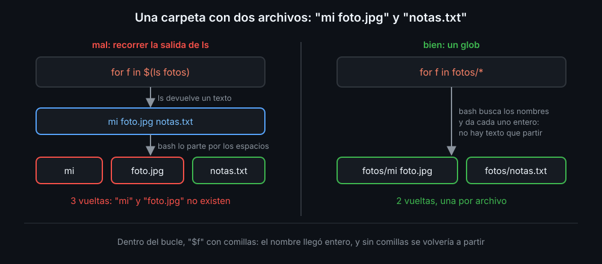

# for

Un bucle repite un bloque de comandos. `for` lo repite **una vez por elemento** de una lista, y en cada vuelta la variable vale un elemento.

```bash
for host in web-01 web-02 db-01; do
  echo "comprobando $host"
done
```

`do` abre el bloque y `done` lo cierra. En la terminal cabe en una línea: `for h in a b; do echo "$h"; done`.

## De dónde sale la lista

| Lista | Ejemplo | Vueltas |
|---|---|---|
| palabras escritas a mano | `for x in uno dos tres` | 3 |
| un rango | `for i in {1..5}` | 1, 2, 3, 4, 5 |
| un glob | `for f in logs/*.log` | un archivo por vuelta |
| los argumentos | `for arg in "$@"` | uno por argumento, sin partir |
| un contador | `for ((i = 1; i <= n; i++))` | de 1 a `n` |

`{1..5}` se expande antes de que el bucle empiece y no acepta variables: `{1..$n}` no funciona. Para un límite que está en una variable, la forma con contador: valor inicial, condición para seguir y lo que cambia en cada vuelta.

## Archivos: un glob, nunca `$(ls)`

`$(ls carpeta)` devuelve un texto, y bash lo parte por los espacios antes de dárselo al `for` (word splitting, semana 05). Un glob lo expande bash y da cada nombre entero:



```bash
for f in fotos/*; do       # bien: "fotos/mi foto.jpg" es una vuelta
  echo "[$f]"
done
```

Dentro del bucle, `"$f"` siempre con comillas: el nombre llegó entero, pero sin comillas se volvería a partir. shellcheck avisa del `$(ls)` con `SC2045`.

## Un glob que no encaja con nada

Si en `fotos/` no hay nada, `fotos/*` no se expande y se queda tal cual: el bucle da una vuelta con un archivo llamado `fotos/*` que no existe. Dos formas de no tropezar:

```bash
shopt -s nullglob          # un glob sin coincidencias desaparece: cero vueltas
for f in fotos/*; do ...

for f in fotos/*; do
  [[ -f $f ]] || continue  # o comprobar dentro que es un archivo de verdad
```

`shopt -s` activa una opción de bash y `shopt -u` la quita. `continue` pasa a la vuelta siguiente (teoría 02).

## Varios niveles

Un `for` puede ir dentro de otro. El de dentro da todas sus vueltas en cada vuelta del de fuera:

```bash
for dir in "$@"; do               # cada carpeta que llega como argumento
  for f in "$dir"/*.log; do       # cada .log de esa carpeta
    echo "$f"
  done
done
```

`bk-clean` (el proyecto) usa esta forma: un `for` sobre las carpetas y, dentro, un bucle sobre lo que encuentra `find` (teoría 04). Un glob no entra en las subcarpetas; `find`, sí.

<!-- nav -->
---

## 🔗 Navegación

| Anterior | Siguiente |
|---|---|
| ← [Semana 07 — Bucles, read y archivos seguros](../README.md) | [Teoría — while, until, break y continue](02-while-until-break-y-continue.md) → |

[↑ Semana 07](../README.md)
