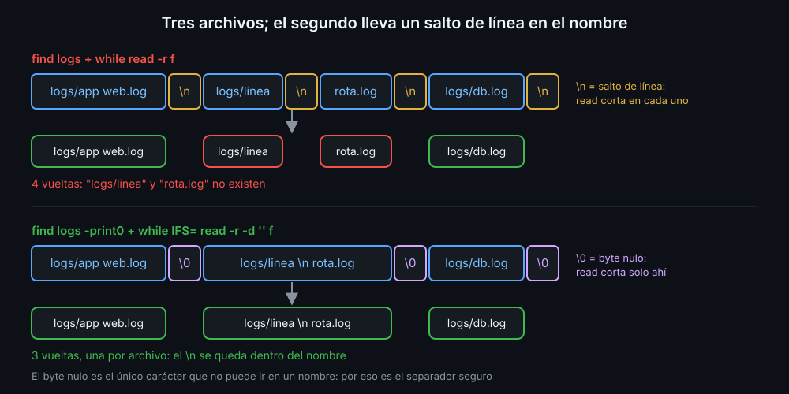
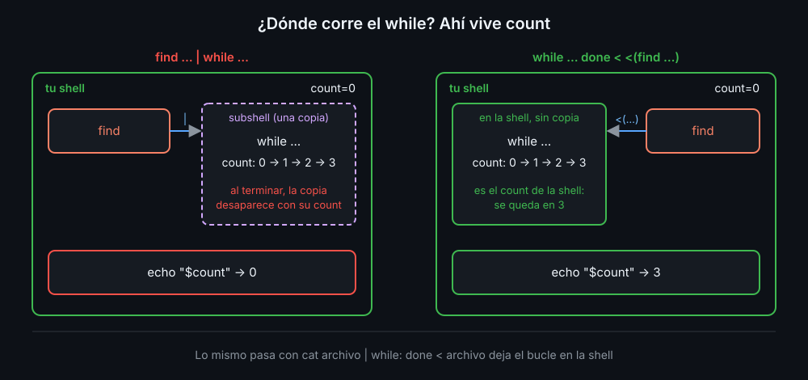

# Archivos con cualquier nombre

Un nombre de archivo en Linux puede llevar **cualquier carácter** salvo `/` y el byte nulo: espacios, `*`, comillas, un `-` delante y hasta saltos de línea. Un script que borra o mueve archivos tiene que funcionar con todos, porque los nombres los pone otro.

## Rutas separadas por el byte nulo

`find` escribe una ruta por línea. Leído línea a línea, un archivo con un salto de línea en el nombre se convierte en dos rutas que no existen. `-print0` termina cada ruta con el byte nulo (`\0`), el único que no puede ir en un nombre, y `read -d ''` lee hasta ese byte:



```bash
while IFS= read -r -d '' f; do
  echo "[$f]"
done < <(find logs -type f -name '*.log' -print0)
```

| Pieza | Para qué |
|---|---|
| `-print0` | cada ruta termina en `\0`, no en salto de línea |
| `-d ''` | `read` lee hasta el siguiente `\0` |
| `IFS=` y `-r` | la ruta llega tal cual, sin recortar ni comerse `\` (teoría 03) |
| `< <(...)` | el bucle no va detrás de un pipe (abajo) |

En la terminal, `find` enseña los caracteres raros como `?`; detrás de un pipe, lo que recibe un script, salen tal cual. Por eso un bucle que "funciona en la terminal" puede fallar en un script.

## El pipe y el subshell

Cada lado de un pipe es un proceso aparte. En `find ... | while ...`, el `while` va en un **subshell**: una copia de la shell con sus propias variables, que desaparece cuando el bucle termina.



```bash
n=0
find logs -print0 | while IFS= read -r -d '' f; do n=$((n + 1)); done
echo "$n"       # 0: se contó en la copia

n=0
while IFS= read -r -d '' f; do n=$((n + 1)); done < <(find logs -print0)
echo "$n"       # el número de verdad
```

`<(comando)` es la salida de un comando vista como un archivo, y `<` se la pasa al bucle igual que `done < archivo`. El `find` corre aparte y el bucle se queda en tu shell. El espacio entre los dos `<` es obligatorio. La semana 13 explica cómo funciona por dentro.

## Lo que viene detrás de `--`

Un comando lee como opción todo lo que empieza por `-`. `rm -x.log` no borra `-x.log`: responde `invalid option -- 'x'`. `--` marca el final de las opciones:

```bash
rm -- "$f"       # "$f" es un nombre, empiece por lo que empiece
```

## Lo que no se toca

Un script que borra se limita a lo que tiene que borrar:

- `-type f`: solo archivos normales. Ni carpetas ni enlaces; `find` no sigue los enlaces, así que nunca sale de la carpeta.
- Validar **antes** del primer `rm`: si una de tres carpetas no existe, no se borra nada en ninguna.
- `--dry-run`: la misma lista, sin borrar. Se mira antes.
- `-mmin +N` en minutos y no `-mtime +N` en días: `-mtime` redondea hacia abajo, y `+7` deja fuera un archivo de 7 días y medio.

<!-- nav -->
---

## 🔗 Navegación

| Anterior | Siguiente |
|---|---|
| ← [Teoría — Leer líneas: read y mapfile](03-leer-lineas-read-y-mapfile.md) | [Índice de labs](../2-practicas/README.md) → |

[↑ Semana 07](../README.md)
