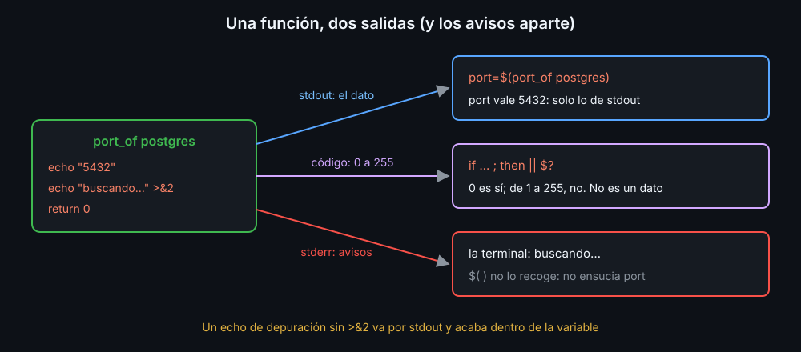

# Funciones, return y salida

Cuando un script repite el mismo bloque en tres sitios, o crece hasta no caber en la pantalla, ese bloque se convierte en una **función**: un trozo de código con nombre que se llama como un comando.

## Definir y llamar

```bash
greet() {               # definir: nombre, (), y el cuerpo entre llaves
  echo "hola, $1"
}

greet ana               # llamar: como cualquier comando
greet "ana maria"       # las comillas funcionan igual: un solo argumento
```

Definir no ejecuta nada. bash lee el script de arriba abajo y una función solo existe a partir de su definición: llamarla antes da `command not found`. Por eso los scripts largos se ordenan así:

```bash
check_file() { ...; }
main() {
  for f in "$@"; do check_file "$f"; done
}

main "$@"               # la última línea: ya están todas definidas
```

## Argumentos

Dentro de una función, `$1`, `$2`, `$#` y `"$@"` son **sus** argumentos, no los del script. `$0` sigue siendo el nombre del script. Si la función necesita los del script, se los pasas: `main "$@"`. Si la llamas sin nada, `"$@"` está vacío y shellcheck avisa (`SC2119`).

## Dos salidas: lo que imprime y su código

Una función devuelve lo mismo que cualquier comando: un texto por stdout y un código de salida de 0 a 255.

```bash
is_port() {                       # responde sí o no: con el código
  [[ $1 =~ ^[1-9][0-9]*$ ]] || return 1
  (($1 <= 65535))                 # sin return, el código es el del último comando
}

port_of() {                       # da un dato: lo imprime
  echo "5432"
}

if is_port "$p"; then ...         # el código, en un if
port=$(port_of postgres)          # lo impreso, con $( )
```



- `return N` termina la función con el código `N`. Un número de 0 a 255: `return 256` da `0`. Nunca uses `return` para devolver un total o un nombre; eso se imprime.
- `$(funcion)` recoge **todo** lo que imprime por stdout. Un `echo` de depuración olvidado dentro de la función acaba en la variable. Los avisos van a stderr (`>&2`), que `$( )` no recoge.
- Con `$( )` la función va en un subshell (semana 07): lo que cambie en variables se pierde.

## return frente a exit

`return` termina la función y el script sigue. `exit` termina el **script entero**, aunque esté dentro de una función:

```bash
is_log() { [[ $1 == *.log ]] || exit 1; }   # mal: para todo en el primer .txt
is_log() { [[ $1 == *.log ]] || return 1; } # bien: responde "no" y sigue
```

`exit` en una función solo tiene sentido cuando el error impide seguir: una función `die` que avisa y termina, como la de `lib/core.sh` del proyecto. Dentro de `$( )`, `exit` solo termina el subshell.

## Una asignación con local

`local x=$(cmd)` sale siempre con el código de `local`, que es `0`: el fallo de `cmd` se pierde y ni `set -e` ni un `if` lo ven (`SC2155`). Declara y asigna en dos líneas:

```bash
local port
if ! port=$(port_of "$name"); then ...
```

## Ver lo que hay

`type nombre` dice si un nombre es una función, un builtin o un programa, y enseña el cuerpo de la función. `declare -F` lista las funciones definidas y `unset -f nombre` borra una.

<!-- nav -->
---

## 🔗 Navegación

| Anterior | Siguiente |
|---|---|
| ← [Semana 08 — Funciones, alcance y librerías](../README.md) | [Teoría — Alcance: local y declare -n](02-alcance-local-y-declare-n.md) → |

[↑ Semana 08](../README.md)
