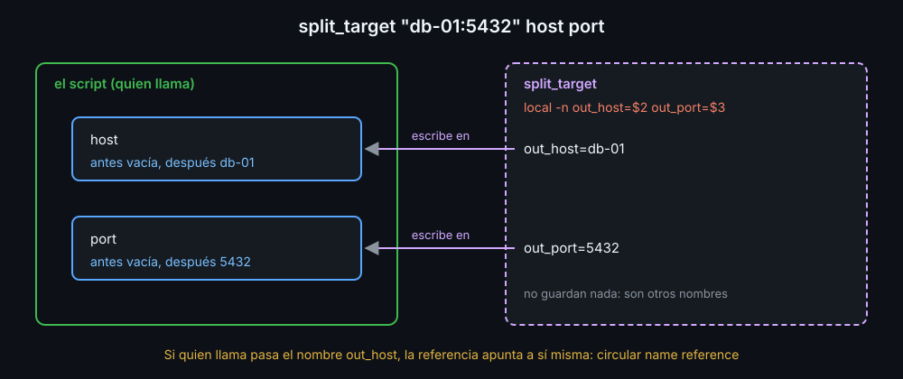

# Alcance: local y declare -n

El **alcance** de una variable es la parte del script que la ve. En bash, la respuesta por defecto sorprende: todo el script.

## Sin local, todo es global

```bash
draw_bar() {
  for ((i = 0; i < $1; i++)); do echo -n "#"; done
  echo
}

for ((i = 0; i < 5; i++)); do
  draw_bar 6              # deja i en 6: el bucle de fuera termina en la primera vuelta
done
```

La `i` de `draw_bar` es la misma que la del bucle de fuera. Cada llamada la cambia: el bucle de fuera da una vuelta en lugar de cinco (con `draw_bar 3`, no terminaría nunca). shellcheck no avisa: para él es un script correcto, porque no sabe qué variables querías compartir.

## local

`local nombre` crea una variable que solo existe mientras dura la función. Si fuera había otra con el mismo nombre, la tapa sin cambiarla, y vuelve a verse al terminar:

```bash
draw_bar() {
  local i                 # esta i es de draw_bar
  for ((i = 0; i < $1; i++)); do echo -n "#"; done
  echo
}
```

La regla: **toda variable de una función, `local`**, incluida la de un `for`. Las que no lo son deberían ser pocas y a propósito, como una configuración que el script lee en varias funciones.

`local` solo existe dentro de una función. Fuera da error: `local: can only be used in a function`.

## Alcance dinámico

Una variable `local` la ven también las funciones a las que llama la suya, mientras está en marcha:

```bash
show() { echo "show ve: $y"; }
caller() { local y=de-caller; show; }
caller                    # show ve: de-caller
echo "[$y]"               # []: fuera de caller, y no existe
```

Funciona, pero una función que lee variables que no recibió es difícil de seguir. Pásale lo que necesite como argumento.

## Devolver varios valores: declare -n

`$(funcion)` devuelve un solo texto. Para dar dos resultados (un host y un puerto), la función puede recibir el **nombre** de las variables donde guardarlos. `declare -n` (dentro de una función, `local -n`) crea una **referencia**: otro nombre para una variable que ya existe.

```bash
split_target() {
  local -n out_host=$2 out_port=$3   # out_host ES la variable que se llame como $2
  out_host=${1%%:*}
  out_port=22
  if [[ $1 == *:* ]]; then out_port=${1##*:}; fi
}

split_target "db-01:5432" host port
echo "$host $port"                    # db-01 5432
```



Sin `$( )` no hay subshell: es más rápido, y la función puede cambiar varias variables a la vez. A cambio:

- **El nombre de la referencia no puede coincidir** con el de la variable a la que apunta. `split_target x out_host port` da `warning: out_host: circular name reference`. Por eso las referencias llevan nombres que nadie usaría fuera, con un prefijo como `out_`.
- shellcheck no sigue la referencia y avisa de que `out_host` se asigna y nadie la lee (`SC2034`). Es un falso aviso. Se apaga solo para esa función, con el porqué en un comentario:

```bash
# out_host y out_port escriben en las variables de fuera, y shellcheck no lo ve.
# shellcheck disable=SC2034
split_target() {
```

Cuándo usar cada forma: `$( )` cuando la función da un solo dato, que es casi siempre; `declare -n` cuando da varios, o cuando tiene que rellenar un array (semana 09).

<!-- nav -->
---

## 🔗 Navegación

| Anterior | Siguiente |
|---|---|
| ← [Teoría — Funciones, return y salida](01-funciones-return-y-salida.md) | [Teoría — source, librerías y dispatcher](03-source-librerias-y-dispatcher.md) → |

[↑ Semana 08](../README.md)
