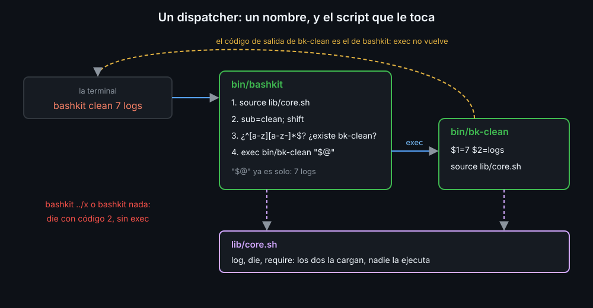

# source, librerías y dispatcher

Cuando varios scripts necesitan las mismas funciones, copiarlas en cada uno obliga a arreglar cada fallo varias veces. Las funciones compartidas van a una **librería**, y cada script la carga.

## source

`source archivo` (o su forma corta, `. archivo`) lee el archivo **dentro de la shell actual**, como si sus líneas estuvieran escritas ahí. `bash archivo`, en cambio, lo ejecuta en otra bash que termina al acabar:

```bash
bash lib/strings.sh       # otra bash define las funciones y desaparece
source lib/strings.sh     # las funciones quedan definidas aquí
to_slug "Informe Anual"   # informe-anual
```

Por eso una librería:

- **No tiene shebang ni bit de ejecución**: no es un comando. La primera línea `# shellcheck shell=bash` le dice a shellcheck qué shell es.
- **Solo define funciones.** Al cargarse no imprime nada ni ejecuta trabajo, y no pone `set -euo pipefail`: las opciones las decide el script que la carga.
- Puede usar `$0`: dentro de una librería, `$0` es el nombre del script que la cargó. Así un aviso dice de qué comando viene.

## Buscar la librería junto al script

Una ruta relativa en `source` se busca desde la carpeta en la que **estás**, no desde la del script. `source lib/core.sh` funciona desde la raíz del kit y falla desde cualquier otra. La ruta del script está en `${BASH_SOURCE[0]}`:

```bash
# shellcheck source=SCRIPTDIR/../lib/core.sh
source "$(dirname "${BASH_SOURCE[0]}")/../lib/core.sh"
```

`dirname` le quita el nombre del archivo y deja su carpeta. Así el script encuentra su librería desde cualquier sitio y llamado por el `PATH`.

shellcheck no abre otros archivos por su cuenta: sin leer la librería, avisa con `SC1091` y no sabe qué funciones trae. `shellcheck -x` sigue los `source`, y el comentario `# shellcheck source=SCRIPTDIR/...` le dice dónde está el archivo cuando la ruta se calcula al ejecutar.

## Dispatcher de subcomandos

`git commit`, `docker compose up`: un solo comando con **subcomandos**. El primer argumento dice qué hacer y el resto son los argumentos de ese subcomando. El script que los reparte es un **dispatcher**: un `case` sobre `$1`, un `shift` para quitarlo y una función por subcomando.

```bash
main() {
  case "${1:-}" in
    add)
      shift
      cmd_add "$@"            # cmd_add recibe solo lo que va detrás de add
      ;;
    list) cmd_list ;;
    -h | --help) usage ;;
    *)
      usage >&2               # desconocido o ninguno: uso por stderr y código 2
      exit 2
      ;;
  esac
}

main "$@"
```

Cuando cada subcomando es un **script aparte** (`bin/bk-clean`, `bin/bk-check`), el dispatcher no llama a una función: ejecuta el archivo.

```bash
[[ $sub =~ ^[a-z][a-z-]*$ ]] || die "'$sub' no es un nombre de subcomando" 2
[[ -x "$bin_dir/bk-$sub" ]] || die "subcomando desconocido: '$sub'" 2
exec "$bin_dir/bk-$sub" "$@"
```



- **Se valida el nombre** antes de usarlo en una ruta: llega de quien escribe en la terminal, y con un `/` podría salir de `bin/`.
- **`exec`** sustituye el dispatcher por el subcomando, sin volver: el código de salida que ve quien llamó es el del subcomando, y no queda un proceso esperando.
- **`"$@"` entre comillas** pasa cada argumento entero: con espacios, vacío o empezando por `-`.

La lista de subcomandos que enseña `help` puede salir de los archivos de `bin/`, con un glob (semana 07): un subcomando nuevo aparece sin tocar el dispatcher.

<!-- nav -->
---

## 🔗 Navegación

| Anterior | Siguiente |
|---|---|
| ← [Teoría — Alcance: local y declare -n](02-alcance-local-y-declare-n.md) | [Índice de labs](../2-practicas/README.md) → |

[↑ Semana 08](../README.md)
