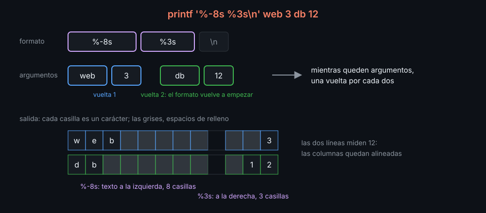

# printf y tablas

`echo` escribe lo que le das. `printf` escribe un **formato** y cambia cada `%` por el argumento que le toca. Es lo que hace falta para alinear columnas, escribir números con ceros o decimales, y escribir datos sin que se malinterpreten.

## Formato y argumentos

```bash
printf '%s tiene %d servidores\n' web 3   # web tiene 3 servidores
```

- `%s` es un texto; `%d`, un entero; `%%`, un `%`. `\n` es el salto de línea: `printf` no lo añade solo.
- Si sobran argumentos, el formato **vuelve a empezar**. Por eso `printf '%s\n' "${arr[@]}"` escribe un elemento por línea. Si faltan, los `%` que quedan valen vacío o `0`.



## Anchos

Un número entre `%` y la letra es el **ancho**: rellena con espacios hasta esa medida.

| Formato | Con `web` | Para qué |
|---|---|---|
| `%6s` | `   web` | números y textos alineados a la derecha |
| `%-6s` | `web   ` | nombres alineados a la izquierda |
| `%*s` | el ancho llega como argumento: `printf '%*s' 6 web` | anchos calculados por el script |
| `%05d` | `00042` con `42` | rellenar con ceros |
| `%.1f` | `3.1` con `3.14159` | decimales |

Para una tabla, el ancho de la primera columna es el del texto más largo. Se calcula con `${#name}` en un bucle y se pasa con `*`. Un mismo formato para la cabecera, las filas y el total garantiza que todo cuadre:

```bash
row() { printf '%-*s %5s %6s\n' "$width" "$@"; }
row COMANDO VECES FALLOS
row deploy.sh 2 1
row TOTAL 2 1
```

## printf -v

`printf -v var formato...` guarda el resultado en `var` en lugar de escribirlo. Hace lo mismo que `var=$(printf ...)` sin lanzar un subshell. Un truco frecuente: N espacios con `%*s` y un texto vacío, y luego cambiarlos por otro carácter.

```bash
printf -v bar '%*s' 8 ''      # ocho espacios
echo "${bar// /#}"            # ########
```

## El formato, siempre fijo

`printf` interpreta su primer argumento. Si un dato va dentro del formato y lleva un `%`, `printf` lo lee como una instrucción:

```bash
role='100% remoto'
printf "$role\n"              # printf: `r': invalid format character
printf '%s\n' "$role"         # 100% remoto
```

El formato, entre comillas simples y sin variables; los datos, como argumentos. shellcheck lo marca con `SC2059`.

## printf cuenta bytes

En UTF-8, una letra con tilde o una `ñ` ocupa dos bytes, y el ancho de `printf` en bash cuenta **bytes**: `printf '%-6s|' José` deja un espacio de menos. `${#name}`, en cambio, cuenta caracteres. Para alinear textos con tildes, se escribe el texto y después los espacios que faltan:

```bash
printf '%s%*s|\n' "$name" $((6 - ${#name})) ''
```

Los números y los nombres de comandos no tienen tildes: con ellos, `%-*s` basta.

## Lo que hay que recordar

- El formato se repite mientras queden argumentos.
- `-` alinea a la izquierda, `*` toma el ancho de un argumento, `%%` es un `%`.
- Nunca un dato dentro del formato.
- El ancho cuenta bytes; `${#var}`, caracteres.

<!-- nav -->
---

## 🔗 Navegación

| Anterior | Siguiente |
|---|---|
| ← [Teoría — Arrays asociativos](02-arrays-asociativos.md) | [Índice de labs](../2-practicas/README.md) → |

[↑ Semana 09](../README.md)
