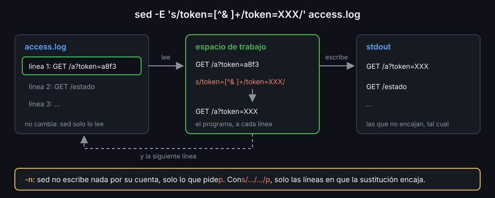

# sed: editar texto línea a línea

Hasta ahora, cambiar un texto era `${var//a/b}` (semana 05): bien para una variable, lento para un archivo de miles de líneas. `sed` (*stream editor*) hace esos cambios sobre un archivo o un pipe entero, sin abrir un editor.

## Cómo trabaja

`sed` lee una línea, la guarda en su **espacio de trabajo** (*pattern space*), le aplica el programa, la escribe en stdout y pasa a la siguiente. El archivo que lee **no cambia**: la salida es una copia.



```bash
sed 's/http:/https:/' urls.txt          # escribe urls.txt con el cambio; urls.txt sigue igual
```

## Sustituir: s/regex/reemplazo/

```bash
echo "uno dos uno" | sed 's/uno/1/'            # 1 dos uno: solo la primera vez
echo "uno dos uno" | sed 's/uno/1/g'           # 1 dos 1: g, todas
echo "garcía ana" | sed -E 's/([^ ]+) (.+)/\2 \1/'   # ana garcía
echo "puerto 8080" | sed -E 's/[0-9]+/[&]/'    # puerto [8080]
echo /var/log | sed 's|/var|/srv|'             # /srv/log: | como separador
```

- La regex es la de `grep` (semana 04). Con `-E`, la extendida: `( )`, `+`, `?`, `|` y `{3}` funcionan sin `\`. En este bootcamp, siempre `-E`.
- En el reemplazo, `\1` es lo que encajó en el primer grupo `( )`, y `&`, todo lo que encajó.
- El carácter detrás de la `s` es el separador. Con rutas, `|` evita escribir `\/` en cada barra.
- `-e` añade un programa más; `sed` los aplica en orden a cada línea.

## Qué líneas: direcciones y rangos

Delante del comando puede ir una dirección, y el comando solo se aplica a las líneas que encajan:

```bash
sed -n 3p app.conf                     # la línea 3
sed -n '2,4p' app.conf                 # de la 2 a la 4
sed -n '/^\[database\]/,$p' app.conf   # de la primera [database] a la última línea ($)
sed '/^#/d; /^$/d' app.conf            # sin comentarios ni líneas vacías
sed '/^\[server\]/,/^\[/ s/^port=.*/port=9090/' app.conf   # el port= de [server], solo
```

- `-n` hace que `sed` no escriba nada por su cuenta; `p` escribe la línea. `sed -n '/regex/p'` es un `grep`, y `sed -nE 's/.../.../p'` escribe solo las líneas en que la sustitución encajó: así se sacan campos y se descarta lo que no tiene el formato.
- `d` borra la línea de la salida.
- Un rango entre dos regex va de la primera que encaja con la de inicio a la siguiente que encaja con la de fin, las dos incluidas.

## Cambiar el archivo: -i

```bash
sed -i 's/workers=2/workers=4/' app.conf       # cambia app.conf; no escribe nada
sed -i.bak 's/workers=2/workers=4/' app.conf   # y guarda el de antes en app.conf.bak
```

`-i` no tiene papelera. Prueba el programa sin `-i`, mira la salida, y solo entonces cámbialo, con `.bak` si el archivo importa. Es la sintaxis de GNU `sed`, la del laboratorio; el `sed` de macOS pide `-i ''`.

## Las trampas

- **`sed` sale con `0` aunque no cambie nada.** Si la regex no encaja, no hay error: compruébalo antes con `grep -q`.
- **Variables dentro del programa.** Con comillas dobles, bash pone el valor de `$port` antes de que `sed` lea el programa. Un valor con `/`, `&` o `\` rompe la regex o el reemplazo: valida lo que entra (solo dígitos, solo letras) o no lo metas en el programa.
- **`.` es cualquier carácter.** `s/10.0.0.5/x/` también cambia `10a0b0c5`. El punto de verdad es `\.`.

<!-- nav -->
---

## 🔗 Navegación

| Anterior | Siguiente |
|---|---|
| ← [Semana 10 — sed, awk y jq](../README.md) | [Teoría — awk: trabajar por columnas](02-awk.md) → |

[↑ Semana 10](../README.md)
