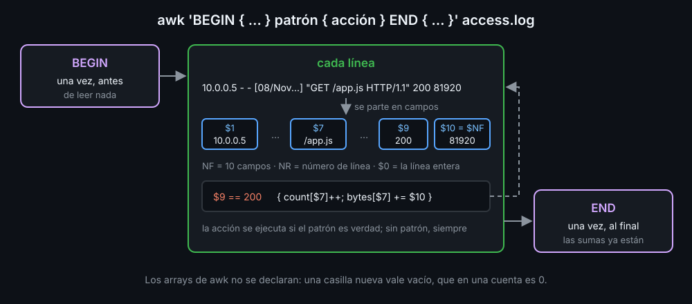

# awk: trabajar por columnas

`sed` ve cada línea como un texto. `awk` la ve como una fila de **campos**: el tercero, el último, cuántos hay. Y tiene variables, cuentas y arrays: lo que en bash era un `while read` con un array asociativo (semana 09) suele ser una línea de `awk`.

## Campos

`awk` parte cada línea por los espacios (varios seguidos cuentan como uno) o por lo que digas con `-F`:

```bash
echo "web-01   10.0.0.5  activo" | awk '{ print $2 }'   # 10.0.0.5
awk -F: '{ print $1, $NF }' /etc/passwd                 # usuario y shell
```

| Nombre | Qué es |
|---|---|
| `$1`, `$2`... | los campos de la línea; `$0`, la línea entera |
| `NF` | cuántos campos tiene la línea; `$NF`, el último |
| `NR` | el número de la línea que se está leyendo |
| `FS`, `OFS` | el separador de entrada (`-F`) y el de salida |

En `print`, la coma pone `OFS` (un espacio, si no dices otro) entre los valores. El programa va siempre entre comillas simples: `$2` es de awk, no de bash.

## patrón { acción }

Un programa de awk es una lista de reglas. Cada línea pasa por todas, y la acción se ejecuta si el patrón es verdad:

```bash
awk -F: '$3 >= 1000 { print $1 }' /etc/passwd          # uid de 1000 o más
awk '$9 ~ /^5/' access.log                             # códigos 5xx: sin acción, escribe la línea
awk 'NR == 1, NR == 3' access.log                      # un rango, como en sed
```

Sin patrón, la acción va a todas las líneas. `~` y `!~` comprueban una regex; `&&`, `||` y `!` funcionan como en `[[ ]]`.

## BEGIN, END y arrays



```bash
awk '
  BEGIN { print "código peticiones" }     # antes de la primera línea
  { count[$9]++ }                         # en cada línea
  END { for (c in count) print c, count[c] }   # después de la última
' access.log
```

- Los arrays de awk son siempre asociativos y no se declaran. Una variable o casilla nueva vale vacío, que en una cuenta es `0`: `count[$9]++` y `sum += $10` funcionan desde la primera línea.
- `for (k in arr)` recorre las claves **sin orden**, como en bash. Ordena después con `sort`; y si hay una cabecera, escríbela fuera de awk, o `sort` la ordenará con las filas.
- `exit N` termina awk con ese código de salida: `END { exit (n > 0) }` hace que bash se entere.

## Funciones que vas a usar

```bash
printf "%-10s %6d\n", $1, $3     # como el printf de bash, con comas entre los argumentos
n = split("10:00:01", t, ":")    # t[1]="10", t[2]="00", t[3]="01"; n=3
gsub(/"/, "\"\"", s)             # sustituye todas las veces dentro de s, como s///g
substr("+0000", 1, 3)            # "+00"
```

Dos textos seguidos se juntan: `"2026" "-" "10"` es `2026-10`. Al cambiar un campo (`$4 = "x"`, o `$1 = $1`), awk rehace la línea con `OFS`: así un `OFS=,` convierte espacios en comas.

## Las trampas

- **Texto o número.** awk compara como número lo que parece un número y como texto lo demás. `"95ms" > "500"` es verdad, porque se comparan letra a letra. `$5 + 0` lo convierte: se queda con las cifras del principio.
- **Variables de bash.** Nunca `awk "\$1 > $limit"`: el valor pasa a ser código. `awk -v limit="$limit" '$1 > limit'` lo pasa como un dato.
- **Campos vacíos con `-F`.** Con espacios, varios seguidos cuentan como uno; con `-F:`, no. `a::b` tiene 3 campos, y `$2` está vacío: así funciona `/etc/passwd`, donde el nombre completo puede faltar.

<!-- nav -->
---

## 🔗 Navegación

| Anterior | Siguiente |
|---|---|
| ← [Teoría — sed: editar texto línea a línea](01-sed.md) | [Teoría — jq: leer y escribir JSON](03-jq.md) → |

[↑ Semana 10](../README.md)
