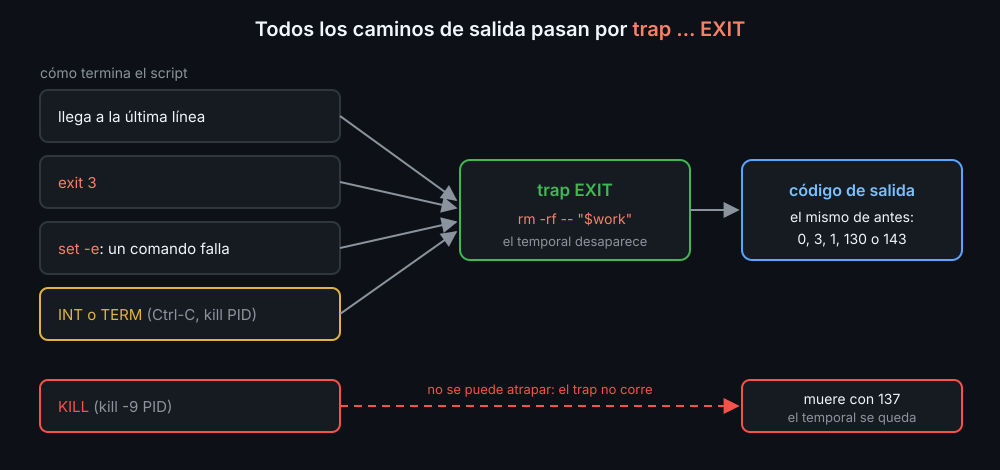

# set -e, trap y mktemp: fallar y limpiar bien

Desde la semana 03, tus scripts empiezan por `set -euo pipefail`. Es un buen principio, pero no un seguro: hay sitios donde `set -e` no para, y cuando para, el script puede dejar basura. Esta semana ves sus límites y cómo limpiar pase lo que pase.

## Dónde no para set -e

`set -e` para el script cuando un comando sale con un código distinto de 0, **salvo** cuando alguien va a mirar ese código:

```bash
f() { false; echo "sigo"; }
f || echo "falló"          # escribe "sigo": dentro de f, set -e está apagado
if f; then ...; fi         # lo mismo: la condición de un if, while o until
false && echo nunca        # lo de la izquierda de && y || no para el script
local x=$(false)           # el código es el de local (0): el fallo se pierde
```

Y al revés, para cuando no hay error:

```bash
n=0; ((n++))               # (( )) sale con 1 si la cuenta da 0: el script para
```

Los arreglos: `|| return` dentro de las funciones que se llaman desde un `if`; `local x` en una línea y `x=$(...)` en otra; `n=$((n + 1))` en lugar de `((n++))`. `shellcheck` avisa del `local x=$(...)` (`SC2155`). Lo demás tienes que verlo tú.

## mktemp: un sitio propio para los temporales

```bash
tmp="$(mktemp)"          # /tmp/tmp.Xa81fQ2kLp: un archivo nuevo y vacío
work="$(mktemp -d)"      # una carpeta nueva
```

El nombre es nuevo en cada ejecución y solo tú puedes leerlo y escribirlo (`rw-------`). Con una ruta fija (`/tmp/mi-script.txt`), dos ejecuciones a la vez se pisan, y otro usuario puede crearla antes. `TMPDIR=/otra/carpeta` cambia dónde se crean.

## trap: qué hacer al salir

`trap 'comandos' SEÑAL` deja apuntado qué ejecutar cuando llegue esa señal. `EXIT` es una señal especial de bash: llega al terminar el script, de cualquier forma.



```bash
work="$(mktemp -d)"
trap 'rm -rf -- "$work"' EXIT     # justo después de crearla
```

- Va **justo después** del `mktemp`: si algo falla entre los dos, la carpeta se queda.
- Comillas **simples**: `$work` se lee al salir. Con dobles, se pone su valor al escribir el `trap`.
- El código de salida no cambia: un script que falla con 2 sigue saliendo con 2 tras el `trap`.
- Un `trap` nuevo para la misma señal reemplaza al anterior. `trap -p` enseña los que hay y `trap - EXIT` quita el de `EXIT`.

## Señales

Una señal es un aviso del sistema a un proceso. Las tres que vas a ver:

| Señal | Número | Quién la manda | Código si mata |
|---|---|---|---|
| `INT` | 2 | `Ctrl-C` en la terminal | 130 |
| `TERM` | 15 | `kill PID`, systemd, Docker, `timeout` | 143 |
| `KILL` | 9 | `kill -9 PID`, el último recurso | 137 |

El código de un proceso que muere por una señal es 128 + su número. En bash, `EXIT` corre también cuando `INT` o `TERM` terminan el script: para limpiar basta con él. `trap ... INT` o `trap ... TERM` sirven para algo más, como avisar:

```bash
trap 'echo "cancelado" >&2; exit 130' INT
```

Con ese `trap`, `INT` ya no termina el script: sin el `exit`, seguiría. `KILL` no se puede atrapar: el proceso muere sin ejecutar nada, ni el `EXIT`.

Bash atiende las señales entre comando y comando: si llega `TERM` durante un `sleep 30`, el `trap` corre cuando el `sleep` termina.

<!-- nav -->
---

## 🔗 Navegación

| Anterior | Siguiente |
|---|---|
| ← [Semana 11 — Scripts robustos](../README.md) | [Teoría — getopts: leer opciones](02-getopts.md) → |

[↑ Semana 11](../README.md)
