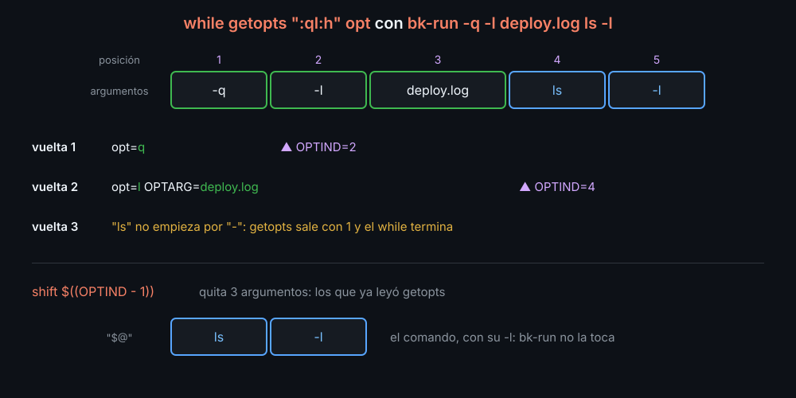

# getopts: leer opciones

Las opciones son los argumentos que empiezan por `-`: `head -n 3`, `ls -la`. Hasta ahora las leías a mano (`if [[ $1 == --dry-run ]]`, semana 07), y eso no aguanta `-la`, ni `-n3`, ni cualquier orden. `getopts` es el builtin de bash que lo hace bien.

## El bucle

```bash
quiet=""
log="bk-run.log"
while getopts ":ql:h" opt; do
  case "$opt" in
    q) quiet=1 ;;
    l) log="$OPTARG" ;;
    h) echo "$usage"; exit 0 ;;
    :) die "a -$OPTARG le falta su valor" 2 ;;
    *) die "opción desconocida: -$OPTARG" 2 ;;
  esac
done
shift $((OPTIND - 1))
# Aquí, "$@" ya es solo lo que va detrás de las opciones.
```

- `":ql:h"` es la lista de opciones, de una letra cada una. Los **dos puntos detrás** de una letra (`l:`) dicen que lleva valor, y el valor llega en `OPTARG`.
- Los **dos puntos del principio** callan los avisos de `getopts` (en inglés) y te dejan los errores: `opt` vale `?` con una opción desconocida y `:` con una a la que le falta el valor; en los dos casos, `OPTARG` dice qué letra fue.
- En el `case`, el último patrón es `*` y no `?`: en un patrón, `?` es "cualquier carácter", y encajaría con todas las letras.
- Los valores por defecto van **antes** del bucle: cada opción solo cambia el suyo.

## OPTIND y el shift



`OPTIND` es la posición del siguiente argumento que `getopts` va a leer. Empieza en 1 y avanza en cada vuelta: una casilla con `-q`, dos con `-l deploy.log`. Cuando el bucle acaba, `shift $((OPTIND - 1))` quita lo leído. Sin el `shift`, `$1` seguiría siendo `-q`.

`getopts` para en lo primero que **no** empieza por `-`, o en `--`:

```bash
bk-run -q ls -l          # -q es de bk-run; ls -l, el comando
bk-run -- -raro.sh       # -- termina las opciones: -raro.sh no es una opción
grep-log.sh INFO app.log -n 1   # getopts para en INFO: -n 1 se queda como argumento
```

Así funcionan los builtins y casi todos los scripts. Los programas de GNU (`ls`, `grep`) reordenan los argumentos y aceptan opciones al final; no cuentes con eso en los tuyos.

## Juntas y pegadas

`getopts` entiende las formas que ya usas en otros comandos:

| Escribes | Lee |
|---|---|
| `-q -v` | `q`, `v` |
| `-qv` | `q`, `v` |
| `-l deploy.log` | `l` con `OPTARG=deploy.log` |
| `-ldeploy.log` | lo mismo, pegado |
| `-ql x` | `q`, y `l` con `OPTARG=x` |

## Lo que getopts no hace

- **Opciones largas** (`--quiet`). Para un script del kit basta con las cortas; si las necesitas, un `case` a mano antes del bucle, como en la semana 07.
- **Comprobar valores.** Si `-n` tiene que ser un número, lo compruebas tú: `[[ $OPTARG =~ ^[0-9]+$ ]] || die ...` (semana 06).
- **Opciones obligatorias.** Una opción es opcional por definición: lo obligatorio va como argumento (`bk-run <comando>`), y se comprueba con `$#` después del `shift`.

Para los mensajes de uso, la costumbre es `uso: nombre [-q] [-l log] <comando>`: entre corchetes lo opcional, entre `< >` lo obligatorio. `-h` escribe el uso en **stdout** y sale con 0 (es lo que se pidió); un error de uso lo escribe en **stderr** y sale con 2.

<!-- nav -->
---

## 🔗 Navegación

| Anterior | Siguiente |
|---|---|
| ← [Teoría — set -e, trap y mktemp: fallar y limpiar bien](01-set-e-trap-y-mktemp.md) | [Teoría — flock, logging e idempotencia: scripts que conviven](03-flock-logging-e-idempotencia.md) → |

[↑ Semana 11](../README.md)
