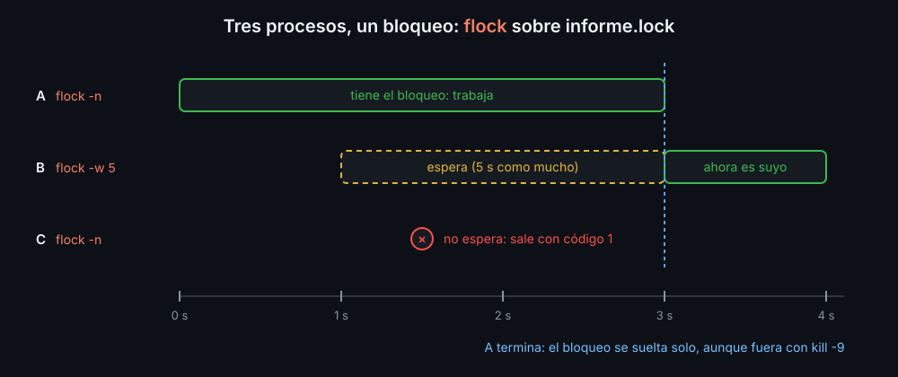

# flock, logging e idempotencia: scripts que conviven

Un script de producción no corre solo: lo lanza un cron cada hora, un compañero a mano, un deploy que se reintenta. Tres costumbres hacen que eso no rompa nada: un **bloqueo** para que no se pisen, **avisos con nivel** para saber qué pasó, y pasos **idempotentes** para poder repetirlo.

## flock: de uno en uno

`flock` pide al sistema un bloqueo sobre un archivo abierto. Solo un proceso lo tiene a la vez; los demás esperan o se rinden.



Para un comando suelto:

```bash
flock -n informe.lock ./informe.sh     # si otro lo tiene, sale con 1 sin esperar
flock -w 10 informe.lock ./informe.sh  # espera como mucho 10 segundos
```

Para un script entero, se abre el archivo en un descriptor y se bloquea ese descriptor:

```bash
exec {lock_fd}> informe.lock     # bash elige un descriptor libre y guarda su número
flock -n "$lock_fd" || die "ya hay otro informe en marcha"
```

- El bloqueo dura **lo que el descriptor siga abierto**: hasta que el script termina, de cualquier forma, también con `kill -9`. No hace falta `trap` para soltarlo.
- Los procesos hijos heredan el descriptor, y con él el bloqueo: si matas el script pero su `sleep` sigue vivo, el bloqueo sigue hasta que el `sleep` acabe.
- El archivo de bloqueo se queda, vacío. No pasa nada: lo que cuenta es el bloqueo, no que exista.
- Todos los que quieran turno tienen que usar `flock` sobre el **mismo** archivo. Un proceso que escribe sin pedir el bloqueo no espera a nadie.

Un archivo con el PID (`echo $$ > script.pid`) no es lo mismo: con `kill -9` se queda escrito, y entre "mirar si existe" y "crearlo" puede colarse otro.

## Avisos con nivel

```bash
log_debug "temporal: $tmp"        # detalle para depurar
log_info  "backup terminado"      # lo normal
log_warn  "disco al 86%"          # algo que mirar
log_error "no hay espacio"        # algo falló
```

Una variable (`LOG_LEVEL`, en el kit `BK_LOG_LEVEL`) dice desde qué nivel se escribe: `debug` lo enseña todo, `error` solo lo grave, `info` es lo normal. Por dentro, cada nivel es un número y se comparan con `(( ))`.

- Los avisos van a **stderr**: stdout queda para los datos, y `$(script)` o `script | jq` no los reciben mezclados.
- Con la hora delante (`date +%FT%T`) y el nivel en mayúsculas: `2026-11-09T02:58:11 WARN disco al 86%`. Así se filtran con `grep`.
- Un cron no tiene pantalla: o rediriges stderr a un archivo (`2>> cron.log`), o la librería escribe además en uno (`LOG_FILE`).
- Un nivel mal escrito en la variable es un error, no un "no escribo nada": callarlo escondería los avisos que pediste.

## Idempotencia

Un script es idempotente si ejecutarlo una vez o diez deja lo mismo. Cada paso **comprueba o tolera** lo que ya existe:

| Paso | Rompe la segunda vez | Idempotente |
|---|---|---|
| crear una carpeta | `mkdir logs` | `mkdir -p logs` |
| añadir una línea | `echo "x=1" >> app.conf` | `grep -qxF "x=1" app.conf \|\| echo "x=1" >> app.conf` |
| apuntar un enlace | `ln -s releases/v2 current` | `ln -sfn releases/v2 current` |
| copiar una plantilla | `cp plantilla.conf local.conf` | `cp --update=none plantilla.conf local.conf` |
| borrar | `rm viejo.log` | `rm -f viejo.log` |

`ln -s` con un `current` que ya apunta a una carpeta no falla: crea el enlace nuevo **dentro** de ella. `-n` lo evita. Un fallo que sale con 0 es peor que uno que para el script.

La forma de comprobarlo es la del lab 07: ejecutar dos veces seguidas y mirar que la segunda no cambia nada.

<!-- nav -->
---

## 🔗 Navegación

| Anterior | Siguiente |
|---|---|
| ← [Teoría — getopts: leer opciones](02-getopts.md) | [Índice de labs](../2-practicas/README.md) → |

[↑ Semana 11](../README.md)
