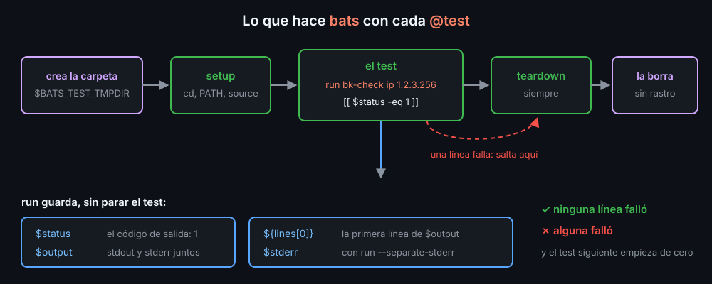

# Tests con bats

Un test es una prueba escrita en un archivo: ejecuta tu script con unos datos y comprueba lo que hace. Cuando cambias algo, lanzas todos los tests con un comando y sabes en segundos si rompiste lo que ya funcionaba.

## Un archivo .bats

**bats** (*Bash Automated Testing System*) ejecuta archivos `.bats`. Cada `@test` es un test: un bloque de bash que pasa si ninguna de sus líneas falla.

```bash
#!/usr/bin/env bats
bats_require_minimum_version 1.5.0     # para run -N y --separate-stderr

@test "una IP con un número mayor que 255 no es válida" {
  run bk-check ip 192.168.1.256
  [[ $status -eq 1 ]]
  [[ $output == "bk-check: '192.168.1.256' no es una IP válida" ]]
}
```

bats ejecuta cada test con `set -e`: la primera línea que falla, para el test y lo marca como fallido. Por eso un script que tiene que fallar se ejecuta con `run`: guarda su código y su salida sin parar el test.

| Después de `run` | Qué guarda |
|---|---|
| `$status` | el código de salida |
| `$output` | stdout y stderr juntos |
| `${lines[@]}` | `$output` partido en líneas: `${lines[0]}` es la primera |
| `$stderr` | solo con `run --separate-stderr`: stderr aparte, y `$output` solo stdout |

`run -1 comando` hace además fallar el test si el código no es `1`. `run` funciona también con funciones: carga una librería con `source` y prueba cada función por separado.

```bash
bats tests                  # todos los .bats de la carpeta
bats tests/bk-run.bats      # uno solo
bats -f "código" tests      # solo los tests con ese texto en el nombre
bats -c tests               # cuántos tests hay, sin ejecutarlos
bats --tap tests            # formato TAP: "ok 1 ..." / "not ok 2 ..."
```

En una terminal, bats escribe `✓` y `✗`; si la salida va a un pipe o a un archivo, TAP. Cuando un test falla, dice el archivo, la línea, la comprobación que falló y lo que escribió el test: un `echo "salida: $output"` antes de comparar te enseña qué salió.

## Cada test, desde cero



Para cada test, bats crea una carpeta vacía, `$BATS_TEST_TMPDIR`, y la borra al terminar. Pero no entra en ella: el test corre donde lanzaste bats. Si tu script escribe un log y el test no cambia de carpeta, el log se queda, y el test siguiente empieza con él. El arreglo va en `setup`, que bats ejecuta antes de cada test:

```bash
setup() {
  cd "$BATS_TEST_TMPDIR" || return
  PATH="$BATS_TEST_DIRNAME/../bin:$PATH"   # BATS_TEST_DIRNAME: la carpeta del .bats
}

teardown() {                                # después de cada test, también si falla
  chmod -R u+w "$BATS_TEST_TMPDIR"          # que bats pueda borrar lo que dejaste sin permisos
}
```

Lo que comparten varios archivos va en un `test_helper.bash`, y cada `.bats` lo carga con `load test_helper` (sin el `.bash`). `skip "motivo"` salta un test que no tiene sentido en este entorno, por ejemplo uno de permisos ejecutado como root.

## Qué probar

- **Lo que ve quien usa el comando**: la salida, el código de salida, qué va a stderr, qué archivos deja. No cómo está escrito por dentro.
- **Un caso bueno y uno malo** de cada cosa: una IP válida y una con un 256; un log normal y uno con un código de tres cifras.
- **Los fallos que ya encontraste**, con un test de regresión: primero el test, que tiene que fallar; después el arreglo, que lo hace pasar. Un test que nunca has visto fallar no sabes si comprueba algo.

¿Tus tests sirven? Rompe el script a propósito, en una copia, y pásalos: si siguen pasando, no comprueban lo que crees.

```bash
kit=$(mktemp -d); cp -r . "$kit"
sed -i 's/exit 1$/exit 0/' "$kit/bin/bk-check"
bats "$kit/tests/bk-check.bats"      # tiene que fallar algún test
rm -rf "$kit"
```

<!-- nav -->
---

## 🔗 Navegación

| Anterior | Siguiente |
|---|---|
| ← [Teoría — shellcheck y shfmt: revisar sin ejecutar](01-shellcheck-y-shfmt.md) | [Teoría — Depurar y medir: set -x, trap ERR y time](03-depuracion-y-rendimiento.md) → |

[↑ Semana 12](../README.md)
