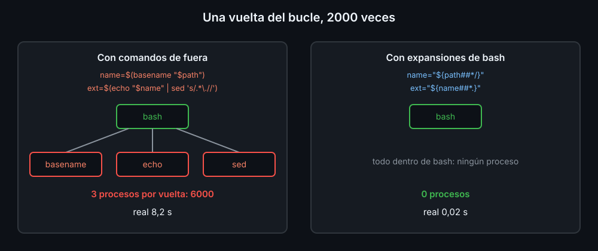

# Depurar y medir: set -x, trap ERR y time

Un test que falla te dice **qué** está mal. Para saber **por qué**, hay que ver qué hace el script por dentro. Y a veces el script está bien, pero tarda demasiado.

## La traza: set -x

Con `set -x`, bash escribe en stderr cada línea antes de ejecutarla, con las variables ya cambiadas por su valor:

```bash
bash -x script.sh datos          # el script entero con traza
set -x; ...; set +x              # solo un trozo, dentro del script
bash -n script.sh                # sin ejecutar: solo comprueba la sintaxis
```

```text
+ total=0
++ stat -c %s datos/ventas.csv
+ size=1500
```

`+` es una línea; `++`, una que va dentro de otra, en un subshell (`$( )`, un lado de un pipe). Lo que va delante de cada línea es el valor de `PS4`, y puede llevar variables. Con comillas simples, se calculan en cada línea:

```bash
PS4='+ ${BASH_SOURCE[0]##*/}:${LINENO}: '                 # archivo y línea
PS4='+ ${LINENO} [subshell ${BASH_SUBSHELL}] '             # y en qué subshell
PS4='+ ${LINENO}: ${FUNCNAME[0]:+${FUNCNAME[0]}(): }'      # y en qué función
```

`$BASH_SUBSHELL` vale `0` en la shell del script y sube en cada copia: así se ve que el `while` detrás de un pipe corre aparte, y que lo que cambia se pierde.

La traza va a stderr, mezclada con los avisos del script. `BASH_XTRACEFD` es el descriptor al que escribe `set -x`: ábrelo en un archivo y la traza va aparte.

```bash
if [[ -n ${TRACE:-} ]]; then
  exec {BASH_XTRACEFD}> "$TRACE"    # un descriptor nuevo, guardado en BASH_XTRACEFD
  PS4='+ ${LINENO}: '
  set -x
fi
```

Dejarlo en el script no cuesta nada: sin `TRACE`, no hace nada. En `bashkit` es `BK_TRACE`, en `lib/core.sh`.

## trap ERR: dónde se paró

`set -e` para el script en el primer comando que falla, sin decir cuál. `trap ... ERR` se ejecuta en cada fallo, y `$LINENO` y `$BASH_COMMAND` (el comando que falló) dicen dónde:

```bash
trap 'echo "falló la línea $LINENO: $BASH_COMMAND" >&2' ERR
```

```text
falló la línea 13: grep -v -e '^#' -e '^$' "$file"
```

Como `set -e`, `ERR` no salta en las condiciones de un `if` ni a la izquierda de un `||` (semana 11). Dentro de funciones, solo con `set -E`.

## Cuánto tarda: time

`time` mide un comando, un bucle o un pipe entero. `real` es el tiempo que esperas tú; `user` y `sys`, el del procesador. `TIMEFORMAT` elige qué escribe:

```bash
TIMEFORMAT='real %R s'
time bash count-ext.sh muchos       # real 8.179 s
```

## Procesos: lo que cuesta

Un **builtin** (`echo`, `printf`, `read`, `[[`, `(( ))`) va dentro de bash. Un comando de fuera (`sed`, `basename`, `cat`, `wc`) es otro programa, y bash tiene que crear un proceso para él. Cada `$( )` y cada lado de un pipe es, además, un subshell. Una vez no se nota; mil veces en un bucle, sí:



| Lento, dentro de un bucle | Igual, sin comando de fuera |
|---|---|
| `$(basename "$f")` | `${f##*/}` |
| `$(dirname "$f")` | `${f%/*}` |
| `$(echo "$f" \| sed 's/.*\.//')` | `${f##*.}` |
| `$(echo "$s" \| tr a-z A-Z)` | `${s^^}` |
| `$(cat archivo)` | `$(<archivo)` |
| `x=$(printf '%05d' "$n")` | `printf -v x '%05d' "$n"` |
| `$(expr $a + 1)` | `$((a + 1))` |

La regla no es "nunca uses comandos de fuera": es "no los lances una vez por línea". Para un archivo entero, un pipe (`sort | uniq -c`) o un `awk` lanza cuatro procesos en total y gana a cualquier bucle de bash.

<!-- nav -->
---

## 🔗 Navegación

| Anterior | Siguiente |
|---|---|
| ← [Teoría — Tests con bats](02-tests-con-bats.md) | [Índice de labs](../2-practicas/README.md) → |

[↑ Semana 12](../README.md)
