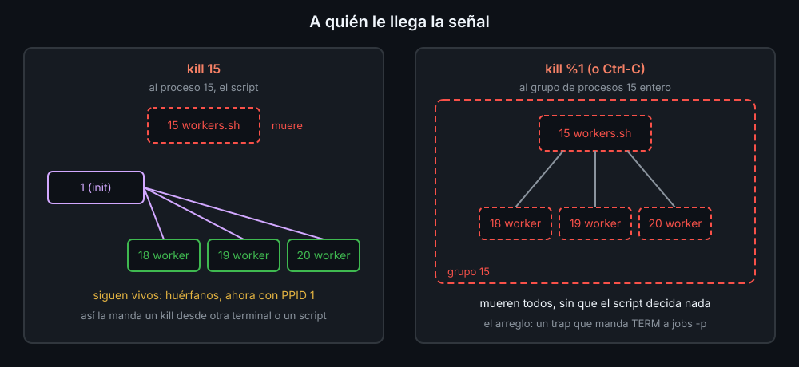

# Señales a los hijos, cron y timers de systemd

Un script que lanza trabajos en segundo plano es su **padre**, y responde de ellos: si muere sin pararlos, se quedan trabajando sin nadie que los controle. Y un script que se ejecuta solo, desde cron o desde un timer, no tiene a nadie delante para pulsar Ctrl-C.

## Señales

| Señal | Número | Quién la manda | Código del que muere |
|---|---|---|---|
| `INT` | 2 | Ctrl-C | 130 |
| `TERM` | 15 | `kill pid`, `timeout` | 143 |
| `KILL` | 9 | `kill -9`, `timeout -k` | 137 (no se puede atrapar ni ignorar) |

`trap 'acción' TERM` decide qué hacer al recibirla; `trap '' TERM` la ignora. Dos detalles que muerden:

- bash ejecuta el `trap` cuando **termina el comando en primer plano**: con un `sleep 30` en marcha, tarda hasta 30 segundos en reaccionar. `wait`, en cambio, se corta en cuanto llega la señal: `sleep 30 & wait $!`.
- Un subshell no hereda los `trap` del script: un worker lanzado con `&` pone los suyos.

## La señal llega a un proceso, no a sus hijos



Desde tu terminal, cada trabajo es un **grupo de procesos** y sus hijos van en él: `kill %1` y Ctrl-C le llegan al grupo entero. Pero `kill <pid>` desde otra terminal o desde otro script le llega solo a ese proceso, y sus hijos quedan **huérfanos** (`PPID 1`). Además, hay programas que se apartan del grupo (`timeout` pone a su comando en uno propio) y un programa que el script lanza con `&` ignora el `INT` de Ctrl-C. La solución es que el script pare a sus hijos:

```bash
cleanup() {
  local pids
  pids="$(jobs -rp)"
  [[ -z $pids ]] || kill $pids 2> /dev/null || true   # sin comillas: un pid por palabra
  wait || true
  rm -rf "$tmp"
}
trap cleanup EXIT
trap 'exit 130' INT
trap 'exit 143' TERM
```

## cron

`crontab -e` abre tu tabla; cada línea, cinco campos de tiempo y un comando:

```text
# minuto  hora  día-del-mes  mes  día-de-la-semana   comando
*/15      9-18  *            *    1-5                /home/ana/bin/check >> /home/ana/check.log 2>&1
```

`*` es cualquiera, `*/15` cada 15, `9-18` un rango, `1,15` una lista; en el día de la semana, 0 y 7 son domingo. `crontab -l` la lista y `crontab -r` la borra.

cron ejecuta el comando **sin terminal y con el entorno casi vacío**: desde tu home, con `PATH=/usr/bin:/bin`, con `sh` y sin tus variables. Lo que funciona en tu terminal puede fallar allí:

| Problema | Arreglo |
|---|---|
| rutas relativas | rutas enteras, o calcularlas en el script desde `BASH_SOURCE` |
| comandos fuera de `/usr/bin:/bin` | ruta entera, o `PATH=...` en la primera línea del crontab |
| nadie ve la salida | `>> log 2>&1` |
| `%` en el comando | cron lo cambia por un salto de línea: escríbelo `\%`, o pon la fecha dentro del script |
| una ejecución pisa a la anterior | `flock -n /tmp/x.lock comando`: si sigue la anterior, no empieza |

Pruébalo como lo vería cron: `env -i HOME="$HOME" PATH=/usr/bin:/bin sh -c 'cd && /ruta/script'`.

## Timers de systemd

Dos archivos. El `.service` dice qué ejecutar; el `.timer`, cuándo:

```ini
# backup.service                   # backup.timer
[Service]                          [Timer]
Type=oneshot                       OnCalendar=Mon..Fri *-*-* 09:00:00
ExecStart=/home/ana/bin/backup     Persistent=true

                                   [Install]
                                   WantedBy=timers.target
```

```bash
systemd-analyze calendar "Mon..Fri *-*-* 09:00:00"   # comprueba y dice la próxima vez
systemd-analyze verify backup.timer                  # comprueba los dos archivos
systemctl --user enable --now backup.timer           # activarlo (en ~/.config/systemd/user/)
systemctl --user list-timers                         # cuándo toca
journalctl --user -u backup.service                  # lo que escribió cada ejecución
```

Frente a cron: guarda el log sin redirecciones, `Persistent=true` recupera la ejecución perdida si la máquina estaba apagada, no lanza una nueva si la anterior sigue en marcha, y al parar el servicio, systemd para también a todos sus hijos.

<!-- nav -->
---

## 🔗 Navegación

| Anterior | Siguiente |
|---|---|
| ← [Teoría — Conectar procesos: <( ), >( ) y coproc](02-process-substitution-y-coproc.md) | [Índice de labs](../2-practicas/README.md) → |

[↑ Semana 13](../README.md)
