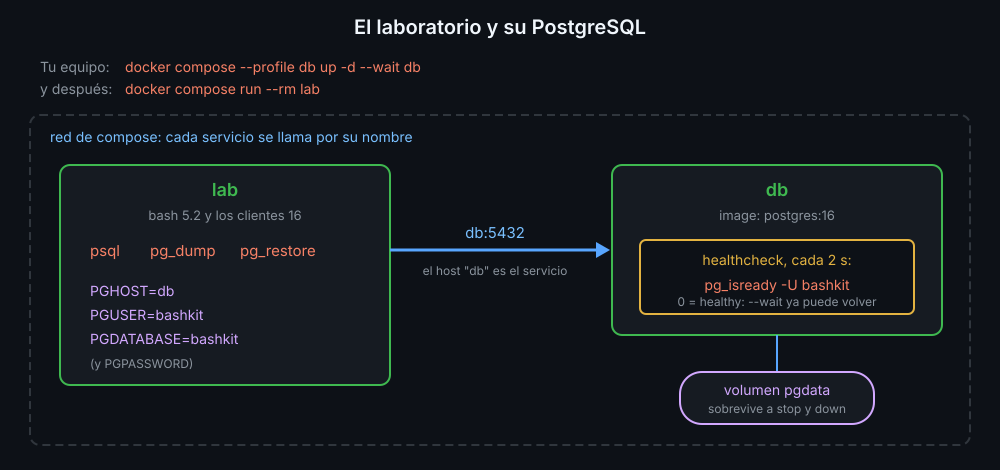

# PostgreSQL en Docker: un servicio, un healthcheck y psql

Esta semana `bashkit` copia una base de datos de verdad. No hace falta instalar PostgreSQL: corre en un contenedor, y los clientes (`psql`, `pg_dump`, `pg_restore`) ya están en el laboratorio.

## El servicio db de compose.yaml

El `compose.yaml` de la raíz del repositorio describe dos **servicios**: `lab`, el de siempre, y `db`, un PostgreSQL 16. `db` lleva `profiles: [db]`: no arranca con el laboratorio, solo cuando lo pides. Desde la raíz del repositorio, en tu equipo:

```bash
docker compose --profile db up -d --wait db   # arranca db y espera a que esté "healthy"
docker compose ps db                          # STATUS: Up 2 seconds (healthy)
docker compose stop db                        # lo para; los datos se quedan
```

`-d` lo deja en segundo plano. `--wait` no vuelve hasta que el **healthcheck** dice que el servicio está sano:

```yaml
healthcheck:
  test: ["CMD", "pg_isready", "-U", "bashkit"]   # el comando que pregunta
  interval: 2s                                   # cada cuánto
  retries: 15                                    # cuántos fallos seguidos hasta "unhealthy"
```

Un contenedor **arrancado** no es un servicio **listo**: PostgreSQL tarda unos segundos en aceptar conexiones después de arrancar. El healthcheck distingue las dos cosas.



## Dentro de la red: el nombre del servicio

Los contenedores de un mismo `compose.yaml` comparten una red, y cada servicio se llama por su nombre: desde `lab`, PostgreSQL está en el host `db`, puerto 5432. No hace falta escribirlo en cada comando: los clientes de PostgreSQL leen estas **variables de entorno**, que el laboratorio ya trae puestas:

| Variable | Valor en el laboratorio | Qué es |
|---|---|---|
| `PGHOST` | `db` | la máquina donde corre PostgreSQL |
| `PGUSER` | `bashkit` | el usuario con el que te conectas |
| `PGPASSWORD` | `bashkit` | su contraseña |
| `PGDATABASE` | `bashkit` | la base de datos |

`PGPASSWORD` está bien en un laboratorio. En un servidor, la contraseña va en `~/.pgpass` con permisos `600`: una variable de entorno la ve cualquiera que liste los procesos con sus variables.

## psql desde un script

`psql` es la consola de PostgreSQL. En un script se usa sin entrar en ella:

```bash
psql -c 'select count(*) from pedidos'      # una consulta, con su tabla y sus bordes
psql -Atc 'select count(*) from pedidos'    # 12: -A sin alinear, -t sin cabecera
n="$(psql -Atc 'select count(*) from pedidos')"
psql -v ON_ERROR_STOP=1 -f datos.sql        # ejecuta un archivo y para al primer error
```

Ojo: sin `ON_ERROR_STOP=1`, `psql -f` sigue después de un error y **sale con 0**. Con él, para y sale con 3.

## pg_isready: ¿responde?

`pg_isready` pregunta si el servidor acepta conexiones, sin usuario ni contraseña, y lo dice con su código de salida:

| Código | Significa |
|---|---|
| 0 | acepta conexiones |
| 1 | responde, pero rechaza conexiones (está arrancando o parando) |
| 2 | no responde (parado, o el host no existe) |
| 3 | no lo ha intentado (opciones mal escritas) |

Con `-q` no escribe nada: solo cuenta el código. Es lo que usa el healthcheck, y lo que usarás en un `until` para esperar a la base desde un script.

## La versión del cliente importa

`pg_dump` no copia un servidor de una versión mayor más nueva que la suya. El laboratorio trae el cliente 16 (el de Ubuntu 24.04); con un servidor 17 fallaría así:

```text
pg_dump: error: aborting because of server version mismatch
pg_dump: detail: server version: 17.11 (Debian 17.11-1.pgdg13+2); pg_dump version: 16.15 (Ubuntu 16.15-0ubuntu0.24.04.1)
```

Por eso el servicio usa `image: postgres:16`, con la versión fija: con `postgres:latest`, un día cambiaría de versión mayor y las copias dejarían de funcionar sin que tocaras nada.

**Los datos viven en un volumen.** `docker compose stop` y `restart` no los tocan; `docker compose down -v` borra los volúmenes, y con ellos la base entera.

<!-- nav -->
---

## 🔗 Navegación

| Anterior | Siguiente |
|---|---|
| ← [Semana 14 — Proyecto integrador: backups de PostgreSQL en Docker](../README.md) | [Teoría — Copias y restauración: pg_dump, pg_restore y una copia que no miente](02-copias-y-restauracion.md) → |

[↑ Semana 14](../README.md)
