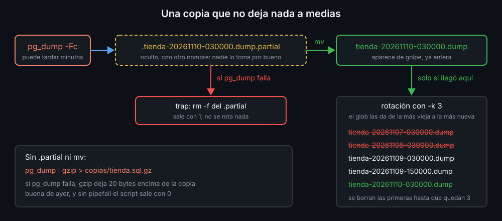

# Copias y restauración: pg_dump, pg_restore y una copia que no miente

Una copia sirve si cumple tres cosas: está entera, sabes de cuándo es y la has restaurado alguna vez. Las tres se consiguen con bash.

## pg_dump: dos formatos

```bash
pg_dump -f tienda.sql          # texto: las órdenes SQL que recrean la base
pg_dump -Fc -f tienda.dump     # formato custom: comprimido, con índice; empieza por PGDMP
```

| | Texto (`.sql`) | Custom (`-Fc`, `.dump`) |
|---|---|---|
| Se lee con | `less`, `grep` | `pg_restore -l` (el índice) |
| Se restaura con | `psql -f` | `pg_restore` |
| Una sola tabla, sin borrar antes | a mano, editando el archivo | `-t tabla`, `--clean` |

`bashkit` usa `-Fc`: va comprimido (con una base de verdad ocupa mucho menos que el texto) y `pg_restore` puede elegir qué restaurar. Mientras copia, la base sigue funcionando: `pg_dump` ve una foto fija del momento en que empezó.

## pg_restore

```bash
pg_restore -l tienda.dump                  # el índice; si falla, no es una copia -Fc
pg_restore -d prueba tienda.dump           # restaura en la base "prueba" (vacía)
pg_restore --clean --if-exists --single-transaction -d bashkit tienda.dump
```

Sobre una base que ya tiene las tablas, hacen falta tres opciones:

- `--clean --if-exists`: borra cada objeto antes de crearlo. Sin ellas, cada `CREATE TABLE` falla porque la tabla ya existe, y los datos se copian **encima** de los que hay.
- `--single-transaction`: todo o nada. Sin ella, `pg_restore` sigue después de cada error y deja la base a medias.

Lo comprobarás en el lab 06: con una vista que depende de `pedidos`, la tabla no se puede borrar. Sin `--single-transaction`, `pg_restore` sale con 1 y deja `pedidos` con **20** filas en lugar de 12 (las 8 que quedaban más las 12 de la copia), duplicadas y sin clave primaria. Con `--single-transaction`, para en el primer error y la base sigue exactamente como estaba.

## Una copia que no miente

Este script parece correcto, pero miente:

```bash
pg_dump | gzip > copias/tienda.sql.gz   # sin pipefail, el código es el de gzip
echo "copia hecha"
```

Si PostgreSQL no responde, `pg_dump` falla, `gzip` comprime una salida vacía y sale con 0: el script dice "copia hecha" **y ha pisado la copia buena de ayer** con un archivo de 20 bytes. Tres arreglos, juntos:

1. `set -o pipefail`: el pipe falla si falla cualquiera de sus comandos.
2. Escribir en un archivo **temporal** de la misma carpeta y, solo si todo salió bien, `mv` al nombre final. `mv` dentro de un mismo sistema de archivos es **atómico**: nadie ve nunca una copia a medias con el nombre bueno.
3. `trap 'rm -f "$partial"' EXIT`: el temporal se borra pase lo que pase.

`pg_dump -f` tiene la misma trampa sin pipe: crea el archivo antes de conectar, y si falla lo deja vacío.



## Rotación: la fecha en el nombre

Con una copia cada noche, el disco se llena. La **rotación** guarda solo las N más nuevas. Si el nombre lleva la fecha de mayor a menor (`tienda-20261110-030000.dump`), ordenar por nombre es ordenar por fecha, y un glob ya sale ordenado:

```bash
printf '%(%Y%m%d-%H%M%S)T\n' -1          # 20261110-030000: la hora actual, sin lanzar date
copies=(copias/tienda-????????-??????.dump)   # de la más vieja a la más nueva
```

Mejor que fiarse de la fecha de modificación (`ls -t`, `find -mtime`): la cambia un `cp` sin `-p`, y al mover las copias a otro disco se pierde el orden.

## Un bloqueo, y el simulacro

Si una copia tarda más de lo previsto y cron lanza la siguiente, dos rotaciones a la vez pueden borrar lo que la otra acaba de escribir. `flock -n` (semana 11) deja pasar a una sola.

Y la regla que no se puede automatizar del todo: **una copia que nunca has restaurado no sabes si sirve**. Restaura de vez en cuando en una base de prueba (`createdb prueba`), o deja que lo haga la CI en cada push.

<!-- nav -->
---

## 🔗 Navegación

| Anterior | Siguiente |
|---|---|
| ← [Teoría — PostgreSQL en Docker: un servicio, un healthcheck y psql](01-postgresql-en-docker.md) | [Teoría — CI con GitHub Actions: los tests en cada push](03-ci-con-github-actions.md) → |

[↑ Semana 14](../README.md)
